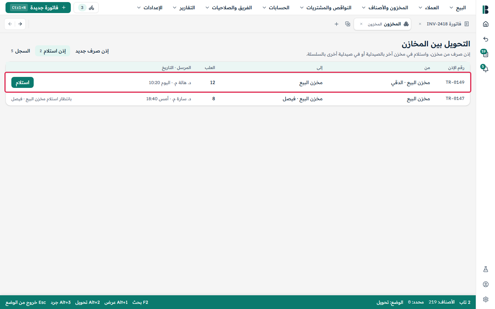
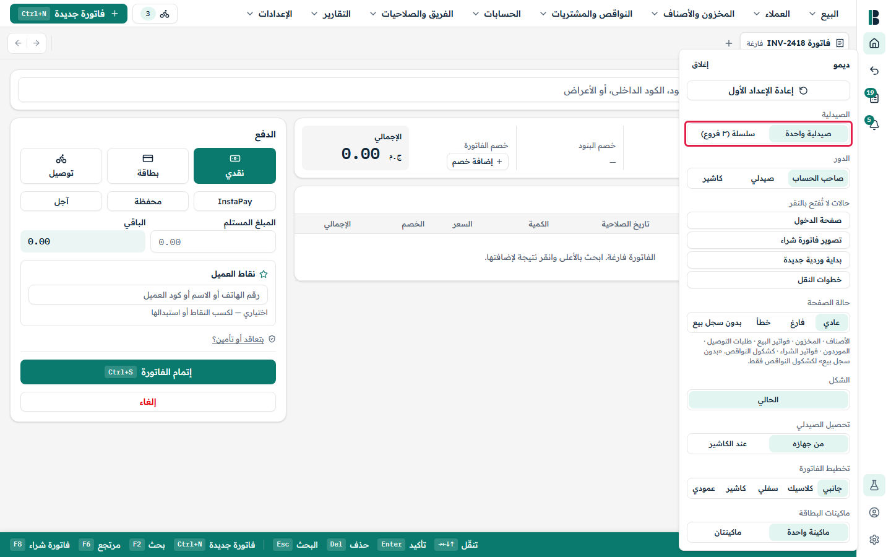
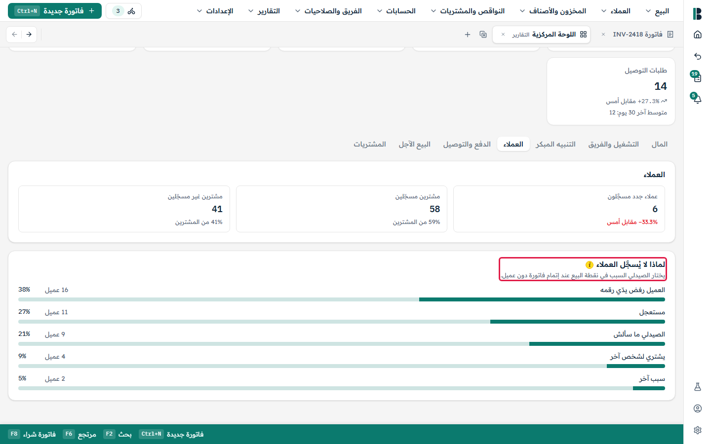
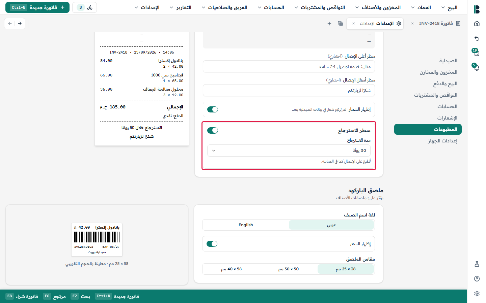
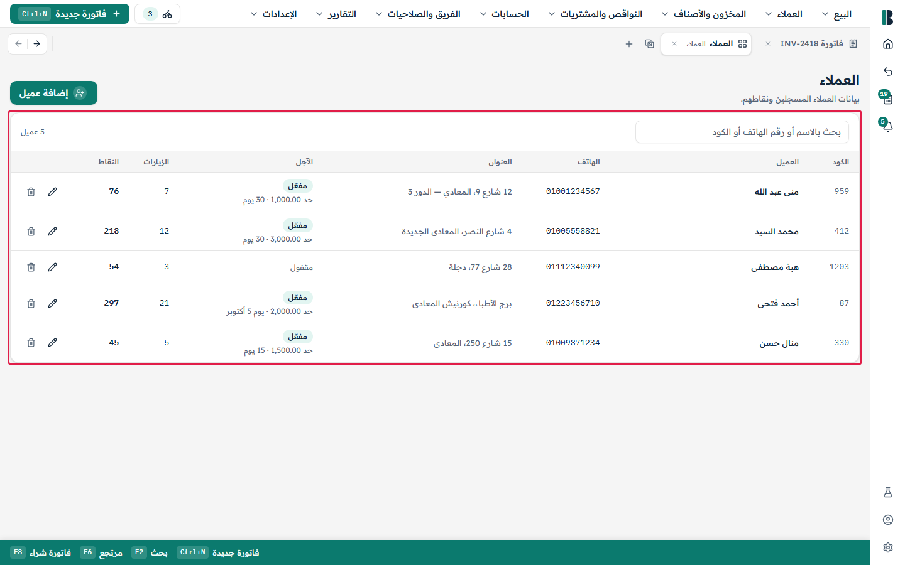

# Buret design review

One section per product question (PQ) and design deviation (D). "Design" is the need-validation
prototype (2026-10-29) at the spot in question; the red outline marks it. "Buret" fills in once the
screen is built. Regenerate with `node capture.mjs` in `tools/review-capture`.

Captured 62 · no screen 1 · failed 0

## Product questions

### PQ-1 · Login: B-Connect credentials or name + PIN on shared tills

تسجيل الدخول

v1 starts with the old B-Connect credentials. Keep that long term, or move to pick-your-name + PIN on shared tills (P3)?

**Where:**

ديمو ← حالات لا تُفتح بالنقر ← صفحة الدخول

**Role:** owner (صاحب الحساب)

**Note:** The design's login is a placeholder: «شاشة الدخول لم تُصمَّم بعد».

| Design | Buret |
|---|---|
|  [video](PQ-1.webm) | not built yet |

### PQ-2 · Cash rounding to 25/50 piasters

تقريب النقدية لأقرب 25 / 50 قرشًا

Round cash totals to 25/50 piasters (O-M1)? The design shows exact piasters.

**Where:**

نقطة البيع ← الدفع ← نقدي ← المبلغ المستلم / الباقي

**Role:** owner (صاحب الحساب)

| Design | Buret |
|---|---|
|  [video](PQ-2.webm) | not built yet |

### PQ-3 · What cannot be sold (expired, near-expiry, recalled, «موقوف البيع»)

ما الذي لا يُباع؟ «موقوف البيع»

Expired batches only, or also near-expiry, recalled or «موقوف البيع» items? Any override (S5b)? The design shows a «موقوف البيع» badge and keeps selling; Omar's lean: it must not sell normally.

**Where:**

المخزون والأصناف ← الأصناف ← فلتر «موقوف البيع» ← «ديكلوفين 50»

**Role:** owner (صاحب الحساب)

| Design | Buret |
|---|---|
|  [video](PQ-3.webm) | not built yet |

### PQ-4 · Item-level extra prices («الأسعار المتاحة»)

الأسعار المتاحة على مستوى الصنف

What are the extra item prices for, who may pick one at the till, and should they belong to a batch (O-S3)?

**Where:**

المخزون والأصناف ← الأصناف ← صنف ← كارت الصنف ← «الأسعار المتاحة» / «إضافة سعر»

**Role:** owner (صاحب الحساب)

| Design | Buret |
|---|---|
|  [video](PQ-4.webm) | not built yet |

### PQ-5 · Transfer awaiting receipt: where is the stock?

تحويل بانتظار الاستلام

Between send and receipt, does the stock stay in the sender until confirmed, or sit in an "in transit" place (O-S5)?

**Where:**

ديمو ← سلسلة ← المخزون والأصناف ← التحويل بين المخازن ← إذن استلام

**Role:** owner (صاحب الحساب)

**Note:** Pending receipts exist only in chain mode; inside one pharmacy the design transfers immediately («يُنفَّذ التحويل فورًا دون استلام»).

| Design | Buret |
|---|---|
|  [video](PQ-5.webm) | not built yet |

### PQ-6 · VAT / tax reports

تقارير الضرائب

Does Buret need VAT or tax reports (for the accountant or e-invoicing), or only correct VAT amounts on each purchase line (O-M3)? The design has a monthly VAT page.

**Where:**

الحسابات ← الضرائب

**Role:** owner (صاحب الحساب)

| Design | Buret |
|---|---|
|  [video](PQ-6.webm) | not built yet |

### PQ-7 · Count finds an expiry with no batch («إضافة تاريخ صلاحية»)

الجرد: إضافة تاريخ صلاحية غير موجود

What does posting the count do with a newly found expiry: new batch, at what cost, who approves? The design is silent (stock Q36).

**Where:**

المخزون والأصناف ← الجرد ← جرد جديد (الكمية والصلاحية) ← بدء الجرد ← صنف ← «إضافة تاريخ صلاحية»

**Role:** owner (صاحب الحساب)

| Design | Buret |
|---|---|
|  [video](PQ-7.webm) | not built yet |

### PQ-8 · No-expiry items («بدون صلاحية»)

Which kinds of items may have no expiry date, and are they sold like any other (stock spec, round 2)?

**Design:** no screen (the design has no «بدون صلاحية» option; every batch has an expiry).

### PQ-9 · Posting a count («ترحيل الجرد»)

ترحيل الجرد

Does posting correct stock to what was counted, and from which expiry are a count shortage or surplus taken? The design only marks the count posted.

**Where:**

المخزون والأصناف ← الجرد ← جرد جديد (الكمية والصلاحية) ← بدء الجرد ← «ترحيل الجرد»

**Role:** owner (صاحب الحساب)

| Design | Buret |
|---|---|
|  [video](PQ-9.webm) | not built yet |

### PQ-10 · Multi-branch (chain mode) for the pilot?

صيدلية واحدة / سلسلة

Is multi-branch (the design's chain mode) needed for the pilot? v1 is single-branch until then.

**Where:**

ديمو ← الصيدلية: «صيدلية واحدة» / «سلسلة (٣ فروع)»

**Role:** owner (صاحب الحساب)

| Design | Buret |
|---|---|
|  [video](PQ-10.webm) | not built yet |

### PQ-11 · Write-off regulation («محضر إعدام أصناف»)

الإعدام: محضر إعدام أصناف

For a pharmacist: do Egyptian rules require more for a write-off than a manager and a printed «محضر إعدام أصناف» (committee, health-directorate form, controlled drugs)?

**Where:**

المخزون ← المخزن: ليس للبيع ← صف ← «إعدام» ← «ترحيل» ← «طباعة المحضر»

**Role:** owner (صاحب الحساب)

| Design | Buret |
|---|---|
|  [video](PQ-11.webm) | not built yet |

### PQ-12 · Deleting an item: 5-second undo enough?

حذف صنف: «تراجع» 5 ثوانٍ

Is the 5-second undo enough, or should deleted items be viewable and restorable later? Who may delete?

**Where:**

المخزون والأصناف ← الأصناف ← صف ← «حذف» ← رسالة «تراجع»

**Role:** owner (صاحب الحساب)

| Design | Buret |
|---|---|
|  [video](PQ-12.webm) | not built yet |

### PQ-13 · Two batches with the same expiry

تشغيلتان بنفس تاريخ الصلاحية

Two batches with the same expiry (different price or cost): separate rows, as the design's stock page shows?

**Where:**

المخزون والأصناف ← الأصناف ← بانادول إكسترا ← كارت الصنف ← «تواريخ الصلاحية»

**Role:** owner (صاحب الحساب)

**Note:** No seeded item has two batches with one expiry, so this shows where batches are listed: one row per expiry with its own price.

| Design | Buret |
|---|---|
|  [video](PQ-13.webm) | not built yet |

### PQ-14 · The «إعدام» tab in «ليس للبيع»

تبويب «إعدام» في «ليس للبيع»

What belongs in the «إعدام» tab? No flow in the design fills it.

**Where:**

المخزون ← المخزن: ليس للبيع ← تبويبات المصدر ← «إعدام»

**Role:** owner (صاحب الحساب)

| Design | Buret |
|---|---|
|  [video](PQ-14.webm) | not built yet |

### PQ-15 · After a write-off: notify or approve?

بعد الإعدام: «تم إبلاغ المدير»

The design says «تم إبلاغ المدير» but nothing follows, and the bell shows a demo «إعدام بانتظار الموافقة». Notify someone (the owner?) or wait for approval? Until answered it posts directly.

**Where:**

المخزون ← ليس للبيع ← «إعدام» ← «ترحيل الإعدام» (رسالة «تم إبلاغ المدير») ← التنبيهات ← «إعدام بانتظار الموافقة»

**Role:** owner (صاحب الحساب)

| Design | Buret |
|---|---|
|  [video](PQ-15.webm) | not built yet |

### PQ-16 · Reprinting a completed sale's receipt

إعادة طباعة إيصال فاتورة مُتمّة

«فواتير البيع» has no print action. Allowed, by whom, marked as a copy?

**Where:**

البيع ← فواتير البيع ← فتح فاتورة (لا يوجد زر طباعة)

**Role:** owner (صاحب الحساب)

| Design | Buret |
|---|---|
|  [video](PQ-16.webm) | not built yet |

### PQ-17 · Open invoices at drawer handover / logout / tab close

فواتير مفتوحة عند تسليم الدرج

The design drops open invoices silently. Warn, keep, or block?

**Where:**

نقطة البيع (فاتورة بها أصناف) ← البيع ← تسليم الدرج

**Role:** owner (صاحب الحساب)

| Design | Buret |
|---|---|
|  [video](PQ-17.webm) | not built yet |

### PQ-18 · Reason for a sale without a registered customer

سبب عدم التسجيل

The reports need «سبب عدم التسجيل», the POS has no field. Add it? Which reasons?

**Where:**

التقارير ← اللوحة المركزية ← العملاء ← «لماذا لا يُسجَّل العملاء»

**Role:** owner (صاحب الحساب)

| Design | Buret |
|---|---|
|  [video](PQ-18.webm) | not built yet |

### PQ-19 · When does credit («آجل») stop?

قاعدة إيقاف الآجل

Limit only, or also overdue beyond N days? The design marks it undecided.

**Where:**

التقارير ← اللوحة المركزية ← البيع الآجل ← «مواعيد التحصيل»

**Role:** owner (صاحب الحساب)

| Design | Buret |
|---|---|
|  [video](PQ-19.webm) | not built yet |

### PQ-20 · Return window: how are days counted?

مدة الاسترجاع

Calendar days from the invoice date? From delivery for delivery orders?

**Where:**

الإعدادات ← المطبوعات ← الإيصال ← «مدة الاسترجاع»

**Role:** owner (صاحب الحساب)

| Design | Buret |
|---|---|
|  [video](PQ-20.webm) | not built yet |

### PQ-21 · Controlled-drug register («دفتر»)

دفتر الأصناف الجدول

For a pharmacist: is a controlled-drug register required by law beyond the three ticks at sale? What must it hold?

**Where:**

نقطة البيع ← صنف جدول (ترامادول) ← إتمام الفاتورة ← «صنف جدول في الفاتورة»

**Role:** owner (صاحب الحساب)

| Design | Buret |
|---|---|
|  [video](PQ-21.webm) | not built yet |

### PQ-22 · Store credit («رصيد للعميل»)

رصيد للعميل

May a cash, card or delivery sale be refunded as a balance the customer spends later? v1 has none (the design's return screen offers none).

**Where:**

البيع ← إنشاء مرتجع ← اختيار فاتورة ← «طريقة الرد»

**Role:** owner (صاحب الحساب)

| Design | Buret |
|---|---|
|  [video](PQ-22.webm) | not built yet |

### PQ-23 · Points on a return

النقاط عند المرتجع

Buret takes back the points earned on returned items (Omar's call). Confirm. The design's return touches no points.

**Where:**

البيع ← إنشاء مرتجع ← فاتورة عميل ← «ملخص المرتجع»

**Role:** owner (صاحب الحساب)

| Design | Buret |
|---|---|
|  [video](PQ-23.webm) | not built yet |

### PQ-24 · Points expiry change

انتهاء صلاحية النقاط

Does changing «النقاط تنتهي بعد N يوم» affect points already earned?

**Where:**

العملاء ← النقاط ← قواعد النقاط ← «انتهاء صلاحية النقاط»

**Role:** owner (صاحب الحساب)

| Design | Buret |
|---|---|
|  [video](PQ-24.webm) | not built yet |

### PQ-25 · Points on credit («آجل») sales

النقاط في البيع الآجل

The design earns and redeems points immediately on credit sales. Buret assumes no points on credit sales until product says otherwise.

**Where:**

نقطة البيع ← الدفع ← آجل ← عميل ← «نقاط العميل»

**Role:** owner (صاحب الحساب)

| Design | Buret |
|---|---|
|  [video](PQ-25.webm) | not built yet |

### PQ-26 · Contract discount order

ترتيب خصم التعاقد

The design applies the contract after line discounts, then adds invoice and points discounts. Confirm.

**Where:**

نقطة البيع ← «بتعاقد أو تأمين؟» ← اختيار تعاقد

**Role:** owner (صاحب الحساب)

| Design | Buret |
|---|---|
|  [video](PQ-26.webm) | not built yet |

### PQ-27 · Contract taken from the customer

التعاقد من العميل

The editor hint says the contract applies by itself when the customer is picked; the POS needs an explicit pick. Which?

**Where:**

العملاء ← التعاقدات والتأمين ← تعاقد جديد ← «العملاء المرتبطين»

**Role:** owner (صاحب الحساب)

| Design | Buret |
|---|---|
|  [video](PQ-27.webm) | not built yet |

### PQ-28 · Merging duplicate customers

دمج العملاء المكررين

Needed? The design has no merge.

**Where:**

العملاء ← العملاء (لا يوجد دمج)

**Role:** owner (صاحب الحساب)

| Design | Buret |
|---|---|
|  [video](PQ-28.webm) | not built yet |

### PQ-29 · Available credit at the POS

الرصيد المتاح للآجل في نقطة البيع

Show the customer's available credit before Ctrl+S? The design only refuses at completion.

**Where:**

نقطة البيع ← الدفع ← آجل ← عميل

**Role:** owner (صاحب الحساب)

| Design | Buret |
|---|---|
|  [video](PQ-29.webm) | not built yet |

### PQ-30 · Receipt for a credit collection («تحصيل»)

إيصال التحصيل

Print a receipt for a credit collection?

**Where:**

العملاء ← الحسابات الآجلة ← «تحصيل» ← «تحصيل من …»

**Role:** owner (صاحب الحساب)

| Design | Buret |
|---|---|
|  [video](PQ-30.webm) | not built yet |

### PQ-31 · B-Connect customers and balances in onboarding

نقل العملاء وأرصدتهم من B-Connect

How does their review look? The design's onboarding has no customers step.

**Where:**

ديمو ← حالات لا تُفتح بالنقر ← «خطوات النقل» ← «محاكاة: انتهى النقل»

**Role:** owner (صاحب الحساب)

**Note:** The six migration steps end at «المخزون المنقول»; none covers customers or their balances.

| Design | Buret |
|---|---|
|  [video](PQ-31.webm) | not built yet |

### PQ-32 · «العملاء المدينين» / «مدينين» wording (G3)

العملاء المدينين

For the designer: «العملاء المدينين» and «مدينين» on «الحسابات الآجلة» break G3 (مدين only in the journal and trial balance). Keep, or reword?

**Where:**

العملاء ← الحسابات الآجلة ← «العملاء المدينين»

**Role:** owner (صاحب الحساب)

| Design | Buret |
|---|---|
|  [video](PQ-32.webm) | not built yet |

### PQ-33 · Purchase VAT before or after the invoice discount

ض.ق.م قبل خصم الفاتورة أم بعده

Is purchase VAT computed before or after the invoice discount? The design computes it before (VAT on each line, then the invoice discount off the total); marked for an accountant.

**Where:**

النواقص والمشتريات ← فواتير الشراء ← مسودة ← «مراجعة واعتماد» ← سطر «ض.ق.م 14%» + «خصم الفاتورة» ← «إجمالي ض.ق.م»

**Role:** owner (صاحب الحساب)

**Note:** Shown with VAT ticked on the first line and a 10% invoice discount: «إجمالي ض.ق.م» does not change with the discount.

| Design | Buret |
|---|---|
|  [video](PQ-33.webm) | not built yet |

### PQ-34 · Supplier return value: batch cost or accepted price

قيمة مرتجع المورد

For an accountant: is a supplier return valued at the batch cost or at the price the supplier accepts?

**Where:**

المخزون ← المخزن: ليس للبيع ← «مرتجعات للموردين معلّقة» ← «تسجيل رد المورد» ← «السعر» / «قيمة المقبول»

**Role:** owner (صاحب الحساب)

**Note:** The design fills «السعر» with the batch's purchase cost (60.84) and lets it be edited; «قيمة المقبول» = accepted qty × that price.

| Design | Buret |
|---|---|
|  [video](PQ-34.webm) | not built yet |

### PQ-35 · Bill total ≠ sum of lines at approve

إجمالي فاتورة المورد ≠ مجموع السطور

When the printed bill total and the sum of the lines differ at approve, which amount does the pharmacy owe the supplier? The design warns («الفرق: … — راجع السطور») and still allows approve.

**Where:**

النواقص والمشتريات ← فواتير الشراء ← مسودة ← «مراجعة واعتماد» ← شريط «الفرق» أسفل السطور

**Role:** owner (صاحب الحساب)

| Design | Buret |
|---|---|
|  [video](PQ-35.webm) | not built yet |

### PQ-36 · Receiving expired or near-expiry stock

استلام بضاعة منتهية أو قريبة الانتهاء

Block receiving already-expired or near-expiry stock, or allow it with a flag (current plan)? The design has no check at all.

**Where:**

النواقص والمشتريات ← فواتير الشراء ← مسودة ← «مراجعة واعتماد» ← سطر بانادول إكسترا ← «تاريخ الصلاحية» 04/26

**Role:** owner (صاحب الحساب)

**Note:** The seeded draft already has an expired line (04/26; the demo date is 22/9/2026) and nothing flags it.

| Design | Buret |
|---|---|
|  [video](PQ-36.webm) | not built yet |

### PQ-37 · Reversing an approved purchase invoice

إلغاء فاتورة شراء معتمدة

Is reversing an approved purchase invoice needed? v1 corrects by supplier return. The design opens approved invoices read-only with no edit, cancel or reverse.

**Where:**

النواقص والمشتريات ← فواتير الشراء ← فاتورة معتمدة ← «معتمدة — للعرض فقط»

**Role:** owner (صاحب الحساب)

| Design | Buret |
|---|---|
|  [video](PQ-37.webm) | not built yet |

### PQ-38 · Discount % and bonus boxes linked

الخصم والبونص مرتبطان

For a pharmacist: are a supplier line's discount % and bonus boxes really linked, as the design assumes (bonus = qty × discount %, and the same % lowers the pharmacist price)?

**Where:**

النواقص والمشتريات ← فواتير الشراء ← مسودة ← «مراجعة واعتماد» ← سطر ← «خصم %» / «بونص»

**Role:** owner (صاحب الحساب)

**Note:** Shown by typing 10% on the first line (50 boxes): the bonus becomes 5 boxes on its own.

| Design | Buret |
|---|---|
|  [video](PQ-38.webm) | not built yet |

### PQ-39 · A sent order that never arrives

طلبية مرسلة لم تصل

An ordered item stays hidden from the reorder list and the suggestions forever. Cancel, expire, or remind? The design has no cancel, edit or "received" state for a sent order.

**Where:**

النواقص والمشتريات ← كشكول النواقص ← «الطلبات المرسلة» ← «بانتظار فاتورة الشراء»

**Role:** owner (صاحب الحساب)

| Design | Buret |
|---|---|
|  [video](PQ-39.webm) | not built yet |

### PQ-40 · Duplicate supplier bills

فاتورة مورد مكررة

Same bill number and supplier entered twice: warn or block? The design has no check.

**Where:**

النواقص والمشتريات ← فواتير الشراء ← مسودة ← «رقم فاتورة المورد»

**Role:** owner (صاحب الحساب)

**Note:** Shown by giving the draft the number of an approved bill from the same supplier (UP-88015, المتحدة للصيادلة): nothing warns.

| Design | Buret |
|---|---|
|  [video](PQ-40.webm) | not built yet |

### PQ-41 · Purchase drafts: shared or owned

مسودات فواتير الشراء

Are purchase drafts shared by all users, or owned by their creator? The design lists everyone's drafts with no owner and no lock.

**Where:**

النواقص والمشتريات ← فواتير الشراء ← «مسودات بانتظار المراجعة»

**Role:** owner (صاحب الحساب)

| Design | Buret |
|---|---|
|  [video](PQ-41.webm) | not built yet |

### PQ-42 · Supplier minimum order («حد الطلبية»)

حد الطلبية

Should the supplier minimum order do anything (e.g. warn when an order is under it)? The design stores and shows it; nothing uses it.

**Where:**

النواقص والمشتريات ← الموردون ← ابن سينا فارما ← «شروط التعامل» ← «حد الطلبية (ج)»

**Role:** owner (صاحب الحساب)

| Design | Buret |
|---|---|
|  [video](PQ-42.webm) | not built yet |

### PQ-43 · «أعلى خصم»: where does it come from?

أعلى خصم

From the last invoice line, a supplier offer list, or drop it? The design shows demo data.

**Where:**

النواقص والمشتريات ← كشكول النواقص ← عمود «أعلى خصم»

**Role:** owner (صاحب الحساب)

| Design | Buret |
|---|---|
|  [video](PQ-43.webm) | not built yet |

### PQ-44 · The «طلبية مفتوحة — لم تُرسل بعد» card

طلبية مفتوحة — لم تُرسل بعد

Keep or remove this card? Only Ctrl+Enter fills it, and its empty text names a button that does not exist.

**Where:**

النواقص والمشتريات ← كشكول النواقص ← «مقترح حسب معدل البيع» ← تحديد صنف ← Ctrl+Enter ← «كشكول النواقص»

**Role:** owner (صاحب الحساب)

| Design | Buret |
|---|---|
|  [video](PQ-44.webm) | not built yet |

### PQ-45 · How long are bill images kept?

مدة الاحتفاظ بصور الفواتير

For an accountant: how long are supplier bill images kept? The design says nothing about retention.

**Where:**

النواقص والمشتريات ← فواتير الشراء ← مسودة ← «مراجعة واعتماد» ← «إظهار الصورة» / «إخفاء الصورة»

**Role:** owner (صاحب الحساب)

| Design | Buret |
|---|---|
|  [video](PQ-45.webm) | not built yet |

### PQ-46 · Bill reading: provider, waiting and failure states

قراءة صورة الفاتورة

Which paid provider reads bills in production, and what do staff see while a bill is being read and when reading fails? The design has neither state: an upload opens a filled draft at once.

**Where:**

النواقص والمشتريات ← فواتير الشراء ← «فاتورة جديدة» (F8) ← «رفع صورة من الجهاز» ← مسودة جاهزة فورًا

**Role:** owner (صاحب الحساب)

**Note:** The video shows the upload choice, then the filled draft with no step in between.

| Design | Buret |
|---|---|
|  [video](PQ-46.webm) | not built yet |

## Design deviations

### D1 · Write-off permission

صلاحية الإعدام

Design: write-off allowed for the "manager" role directly. Buret: a separate `destroy` capability, default manager + owner (P1).

**Where:**

المخزون ← المخزن: ليس للبيع ← «إعدام» (للمدير فقط)

**Role:** owner (صاحب الحساب)

| Design | Buret |
|---|---|
|  [video](D1.webm) | not built yet |

### D2 · Item delete permission not checked

حذف صنف

Design: the «حذف صنف» permission exists but is never checked; anyone can delete. Buret: the permission is checked (P1). Shown as a pharmacist.

**Where:**

المخزون والأصناف ← الأصناف ← صف ← «حذف» (صيدلي)

**Role:** pharmacist (صيدلي)

| Design | Buret |
|---|---|
|  [video](D2.webm) | not built yet |

### D3 · Delivery order edits

تعديل طلب التوصيل

Design: lines of a registered delivery order are edited in place, total recomputed. Buret: same screens; every change is a new entry; sale final at «تحصيل» (M5/S3).

**Where:**

البيع ← طلبات التوصيل ← طلب ← «إزالة صنف» / «إضافة صنف للطلب»

**Role:** owner (صاحب الحساب)

| Design | Buret |
|---|---|
|  [video](D3.webm) | not built yet |

### D4 · Return of a credit («آجل») invoice

مرتجع فاتورة آجل

Design: «نقدي» refund always offered, so unpaid credit is refunded in cash. Buret: the return first reduces the customer's debt; cash only for the part already paid.

**Where:**

البيع ← إنشاء مرتجع ← فاتورة آجل ← «طريقة الرد»

**Role:** owner (صاحب الحساب)

| Design | Buret |
|---|---|
|  [video](D4.webm) | not built yet |

### D5 · Discount caps bind the owner

حدود الخصم

Design: fixed 20% line / 10% invoice caps bind every role, even the owner. Buret: the owner may exceed them; the caps bind every other role.

**Where:**

نقطة البيع ← بند ← «الخصم» 25% (صاحب الحساب) ← «يتجاوز الحد المسموح للبند (20%)»

**Role:** owner (صاحب الحساب)

| Design | Buret |
|---|---|
|  [video](D5.webm) | not built yet |

### D6 · Return window not checked, editable by anyone

مدة الاسترجاع

Design: «مدة الاسترجاع» printed but never checked; editable by anyone on the returns page. Buret: enforced server-side; a late return needs a capability; the field leaves the returns page. Shown as a pharmacist.

**Where:**

البيع ← إنشاء مرتجع ← «مدة الاسترجاع» (صيدلي)

**Role:** pharmacist (صيدلي)

| Design | Buret |
|---|---|
|  [video](D6.webm) | not built yet |

### D7 · Controlled items: ticks not saved

الأصناف الجدول

Design: the three ticks are not saved; «بيع صنف جدول» never checked. Buret: ticks saved with the sale; the capability is checked.

**Where:**

نقطة البيع ← ترامادول ← إتمام الفاتورة ← «صنف جدول في الفاتورة»

**Role:** owner (صاحب الحساب)

| Design | Buret |
|---|---|
|  [video](D7.webm) | not built yet |

### D8 · Cashier menu

قائمة الكاشير

Design: a cashier sees every «البيع» page. Buret: the menu follows the capabilities (G5). Shown as a cashier.

**Where:**

البيع (قائمة) — دور الكاشير

**Role:** cashier (كاشير)

| Design | Buret |
|---|---|
|  [video](D8.webm) | not built yet |

### D9 · Customer delete

حذف عميل

Design: «حذف» removes the customer; no debt check. Buret: same screen; the customer is archived; refused while they owe.

**Where:**

العملاء ← العملاء ← «حذف» ← «حذف …؟»

**Role:** owner (صاحب الحساب)

| Design | Buret |
|---|---|
|  [video](D9.webm) | not built yet |

### D10 · Customers permissions

صلاحيات العملاء

Design: no customers group; every role edits customers, limits, points rules, contracts. Buret: capabilities for each; quick-add at the POS stays open. Shown as a pharmacist editing credit settings.

**Where:**

العملاء ← الحسابات الآجلة ← «إعدادات الآجل» (صيدلي)

**Role:** pharmacist (صيدلي)

| Design | Buret |
|---|---|
|  [video](D10.webm) | not built yet |

### D11 · Credit collection misses the drawer

التحصيل والدرج

Design: a cash «تحصيل» is recorded but never reaches the drawer's expected cash. Buret: it counts in expected cash.

**Where:**

العملاء ← الحسابات الآجلة ← «تحصيل» ← نقدي

**Role:** owner (صاحب الحساب)

| Design | Buret |
|---|---|
|  [video](D11.webm) | not built yet |

### D12 · Discounts above the total

خصم أكبر من الإجمالي

Design: total clamped to 0. Buret: the invoice is refused (M3).

**Where:**

نقطة البيع ← ابيجينت (4.75) ← نقاط العميل 959 ← «استخدام 40 نقطة» ← خصم البند 20% ← «الإجمالي» 0.00

**Role:** owner (صاحب الحساب)

**Note:** Points are redeemed up to the total first; a 20% line discount added after that pushes the total to −0.20, shown as 0.00.

| Design | Buret |
|---|---|
|  [video](D12.webm) | not built yet |

### D13 · Points on credit sales

النقاط في البيع الآجل

Design: earned and redeemed immediately. Buret: none until product answers PQ-25.

**Where:**

نقطة البيع ← آجل ← عميل ← «نقاط العميل»

**Role:** owner (صاحب الحساب)

| Design | Buret |
|---|---|
|  [video](D13.webm) | not built yet |

### D14 · Points on a return

النقاط عند المرتجع

Design: untouched. Buret: taken back for the returned items (PQ-23 confirms).

**Where:**

البيع ← إنشاء مرتجع ← فاتورة عميل ← «تأكيد المرتجع»

**Role:** owner (صاحب الحساب)

| Design | Buret |
|---|---|
|  [video](D14.webm) | not built yet |

### D15 · Supplier return close

إغلاق مرتجع المورد

Design: «السعر» blank (value 0 unless typed); the supplier is never credited; «مرتجع للمورد» overwrites the set-aside reason. Buret: the price defaults to the batch cost; the accepted value credits the supplier; the original reason is kept.

**Where:**

المخزون ← ليس للبيع ← «مرتجع للمورد» ← «إنشاء مرتجع معلّق» ← «تسجيل رد المورد» ← «قيمة المقبول»

**Role:** owner (صاحب الحساب)

**Note:** In this export «السعر» is not blank: it is pre-filled with the batch cost (145.08), so that part of the deviation no longer shows. The video shows the reason overwrite (أوجمنتين moves from «علبة مكسورة أو تالفة» to «مرتجع بانتظار المورد»). The missing supplier credit has no screen: closing the return changes nothing on the supplier page.

| Design | Buret |
|---|---|
|  [video](D15.webm) | not built yet |

### D16 · Supplier on approve

المورد عند الاعتماد

Design: an unanswered «يمكن تقصد…؟» silently creates a new supplier. Buret: approve waits for the answer.

**Where:**

النواقص والمشتريات ← فواتير الشراء ← مسودة ← «يمكن تقصد: المتحدة للصيادلة؟» (بدون رد) ← «اعتماد الفاتورة» ← الموردون

**Role:** owner (صاحب الحساب)

**Note:** Approved without answering the prompt: the supplier list now has «المتحده للصيادله» (the printed spelling) next to the existing «المتحدة للصيادلة».

| Design | Buret |
|---|---|
|  [video](D16.webm) | not built yet |

### D17 · Labels after approve

الملصقات بعد الاعتماد

Design: the label price comes from an older batch. Buret: the new batch's own price.

**Where:**

النواقص والمشتريات ← فواتير الشراء ← مسودة ← «اعتماد الفاتورة» ← «طباعة الباركود الداخلي»

**Role:** owner (صاحب الحساب)

**Note:** First row: the bill line says «سعر الجمهور» 84.00; the label prints 76.00, the price of a batch already in stock.

| Design | Buret |
|---|---|
|  [video](D17.webm) | not built yet |
