# Buret: questions for the product team

[اقرأ بالعربية](product-questions.ar.md)

This Markdown page shows screenshots only. For the videos inline, open the page version: [product-questions.html](product-questions.html)

31 October 2026

These are the open questions from our review of the design. Each one says what the design does today, what we need you to decide, and what we suggest.

If we don't hear back, we build our suggestion. You can still change it later. A few items say "Until you answer" instead: there, we build that until you decide.

Each item has a screenshot and a short video of the design at that spot. A red outline marks the place.

Questions are grouped by who should answer them. Inside each group, they follow the order we build in: sales and customers first, then stock and purchasing, then setup, then later work. Please answer the early ones first.

The small code next to each title (like PQ-14) is only there so you can point to it when you reply.

**Words we use**

- **Batch (تشغيلة):** boxes of one item that came in together, with one expiry date, one cost and one price.
- **Not for sale (ليس للبيع):** stock taken off sale but still in the pharmacy. Putting it there is called setting it aside.
- **Write-off (إعدام):** destroying not-for-sale stock, which removes it from stock.
- **Count (جرد):** staff count what is on the shelves and compare it with what Buret expects. Posting («ترحيل») closes the count.
- **Credit (آجل):** the customer pays later; the amount goes on their account, up to their credit limit.
- **Collection (تحصيل):** money received later, for a credit balance or a delivery order.
- **Drawer (الدرج):** the cash drawer of one till, handed over from shift to shift.
- **Contract (تعاقد):** an agreement with a company or insurer that pays part of its members' purchases.
- **Reorder list (كشكول النواقص):** the list of items the pharmacy needs to buy.
- **B-Connect:** the system the pharmacies use today. Buret replaces it.
- **First version, trial:** the first version is what the first pharmacies get. The trial is those first pharmacies using it.

## Moaz (flows and scope)

### Sales, returns, customers and the cash drawer

#### `O-P1` What each role may do, and its highest discount

**What the design does today:** The permissions tab in the design is not final. The ready-made cashier setting there cannot sell, which looks wrong.

**What we need you to decide:** What may each role do from the start? What is the highest discount each role may give?

**Our suggestion:** Use the design's sample values: owner has no limit, manager 100%, pharmacist 10%, cashier 0%. The cashier can sell on the sales screen and use the drawer (here we follow the design's list of permissions, not its ready-made cashier setting). The owner can change any of this for each person.

*No screenshot: the design has no screen for this.*

#### `PQ-3` What must not be sold

**What the design does today:** The design shows a «موقوف البيع» (stop-sale) badge on an item, but still lets you sell it.

**What we need you to decide:** Which stock must never be sold: only expired batches, or also stock close to expiry and items marked «موقوف البيع»? Can anyone ever override this?

**Our suggestion:** An expired batch is never sold, by anyone. No override. An item marked «موقوف البيع» can't be added to a new invoice; it shows as not for sale. If it is already on an open invoice, Buret flags it when the sale is finished. Stock close to expiry sells as usual, with the usual warning.

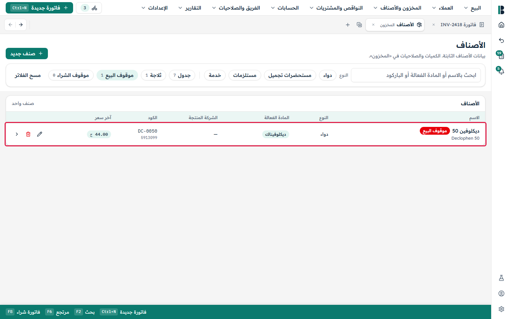

[Video PQ-3](PQ-3.webm)

#### `PQ-4` Extra prices on the item card («الأسعار المتاحة»)

*Also affects the item card.*

**What the design does today:** The item card has a «الأسعار المتاحة» list of extra prices, added with «إضافة سعر». These prices are not tied to a batch.

**What we need you to decide:** What are these extra prices for? Who may choose one at the till? Should each price belong to a batch?

**Our suggestion:** Leave them out of the first version. On the sales screen, the price list shows batch prices only. Choosing one is saved as a choice of batch. A refund always uses the price the customer actually paid.

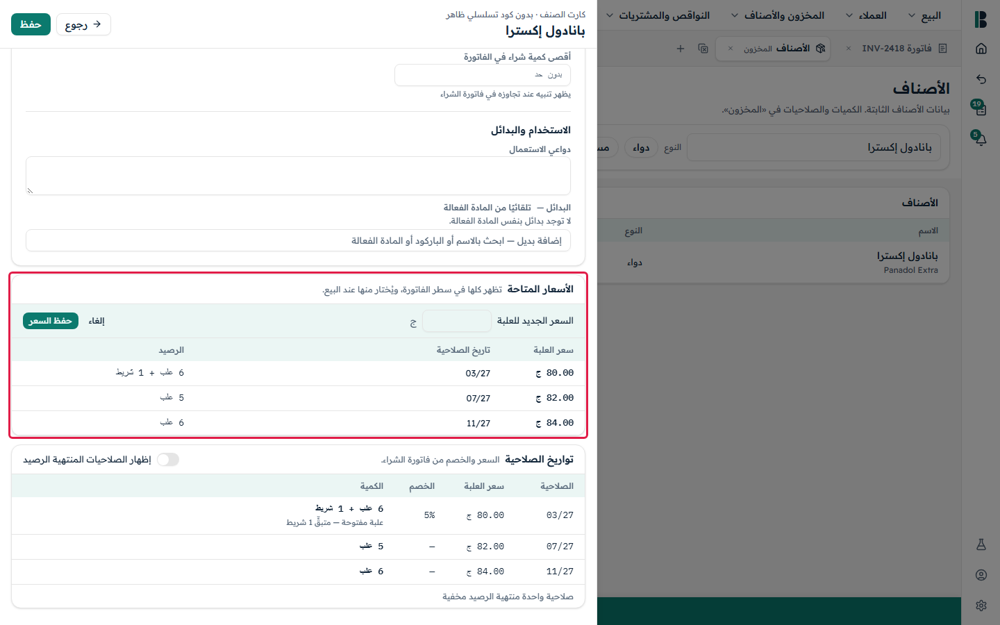

[Video PQ-4](PQ-4.webm)

#### `PQ-2` Rounding cash to 25 or 50 piasters

**What the design does today:** The design shows exact amounts, down to the piaster.

**What we need you to decide:** Should cash totals be rounded to the nearest 25 or 50 piasters («تقريب النقدية»)? If yes, the accountant must also say where the small difference is recorded.

**Our suggestion:** No rounding. Exact piasters, as in the design.

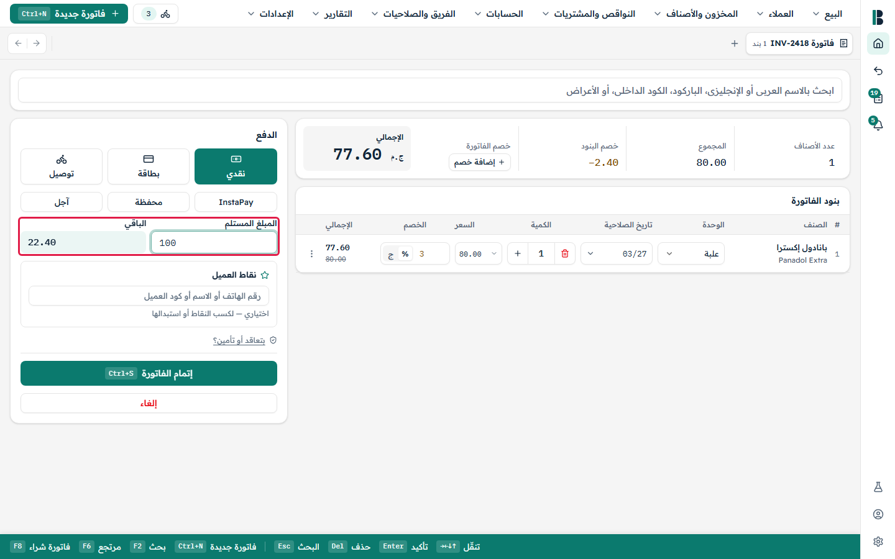

[Video PQ-2](PQ-2.webm)

#### `PQ-17` Open invoices when the drawer is handed over or someone logs out

**What the design does today:** If invoices are still open at drawer handover, at logout, or when the browser tab is closed, the design drops them without a word.

**What we need you to decide:** Should Buret warn, keep the invoices, or stop the action?

**Our suggestion:** Open invoices stay saved for the person who made them. Handover and logout show a warning with a list of them. Deleting an invoice that has items asks for confirmation first.

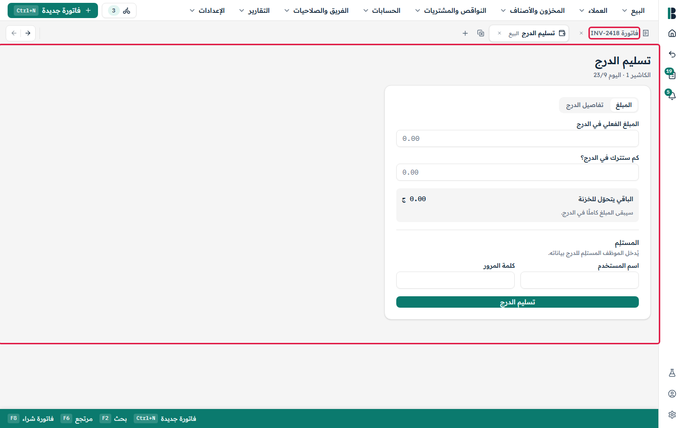

[Video PQ-17](PQ-17.webm)

#### `PQ-16` Printing a finished sale's receipt again

**What the design does today:** The «فواتير البيع» page has no print button.

**What we need you to decide:** May staff print a receipt again? Who may do it? Should the reprint say it is a copy?

**Our suggestion:** Add «طباعة نسخة» in «فواتير البيع». The receipt prints marked «نسخة». Allowed for the owner, manager and pharmacist.

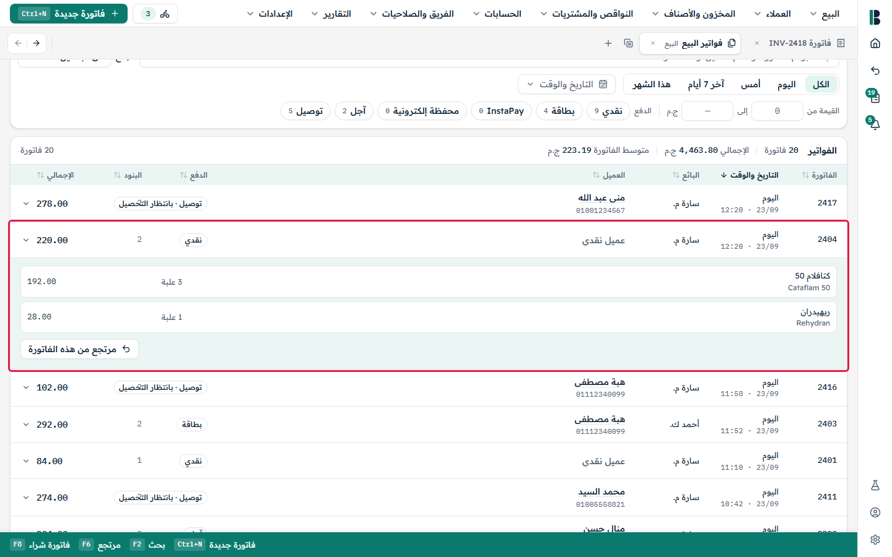

[Video PQ-16](PQ-16.webm)

#### `PQ-19` When a customer can no longer buy on credit («آجل»)

**What the design does today:** The design marks this rule as not decided yet.

**What we need you to decide:** Does credit stop only when the customer reaches their credit limit? Or also when a debt is overdue by more than a set number of days?

**Our suggestion:** Only at the credit limit. We can add a rule for overdue debt later.

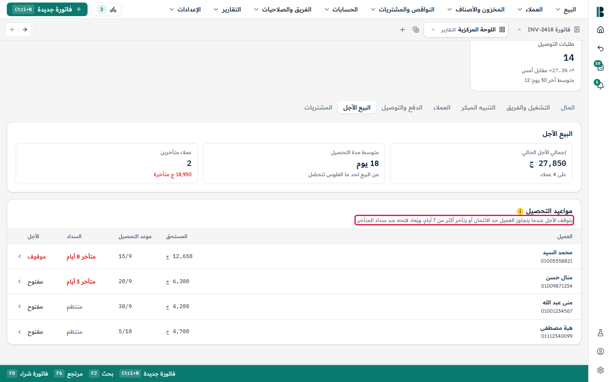

[Video PQ-19](PQ-19.webm)

#### `PQ-29` Showing the credit a customer has left, on the sales screen

**What the design does today:** The design refuses a credit sale only at the very end, when the cashier finishes the sale.

**What we need you to decide:** When the cashier picks credit as the payment, should Buret show how much credit the customer has left, before the sale is finished?

**Our suggestion:** Yes. Show the credit left, and whether the customer has overdue debt, in the credit payment.

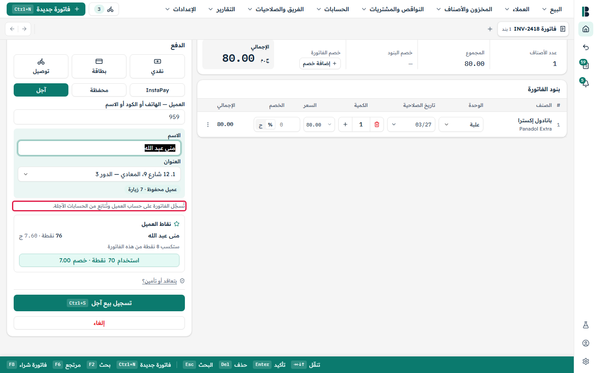

[Video PQ-29](PQ-29.webm)

#### `PQ-22` Giving the money back as a balance («رصيد للعميل»)

**What the design does today:** The design's return screens offer no way to give the money back as a balance.

**What we need you to decide:** When a cash, card or delivery sale is returned, can the money go to the customer as a balance to spend later?

**Our suggestion:** No balance refunds in the first version. The money goes back in cash or the way the customer paid. When a credit invoice is returned, the return first lowers what the customer owes (see D4).

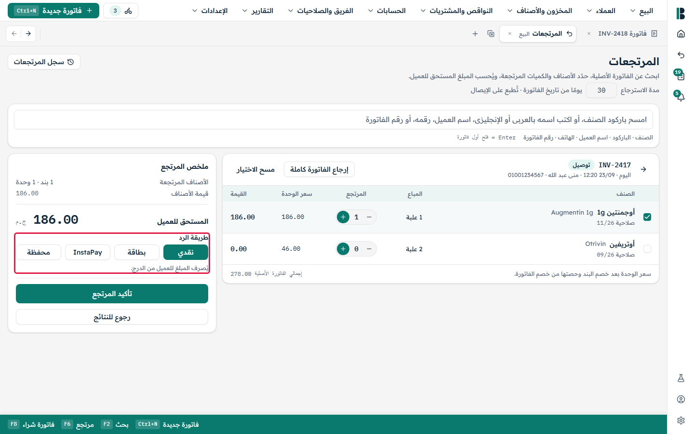

[Video PQ-22](PQ-22.webm)

#### `PQ-23` Points when items are returned

**What the design does today:** In the design, a return does not touch the customer's points. Omar decided that Buret takes back the points earned on the returned items.

**What we need you to decide:** Please confirm this rule.

**Our suggestion:** Take back the earned points in proportion to what was returned, rounded down.

[Video PQ-23](PQ-23.webm)

#### `PQ-25` Points on credit («آجل») sales

**What the design does today:** In the design, a credit sale earns points and lets the customer spend points right away.

**What we need you to decide:** Should credit sales earn or use points?

**Our suggestion:** No. Credit sales don't earn or use points until you decide otherwise (Omar's choice).

[Video PQ-25](PQ-25.webm)

#### `PQ-24` Changing how long points last

**What the design does today:** The points rules have a setting «النقاط تنتهي بعد N يوم» (points end after N days).

**What we need you to decide:** If someone changes this number, does it affect points customers already earned?

**Our suggestion:** No. The new number applies only to points earned after the change.

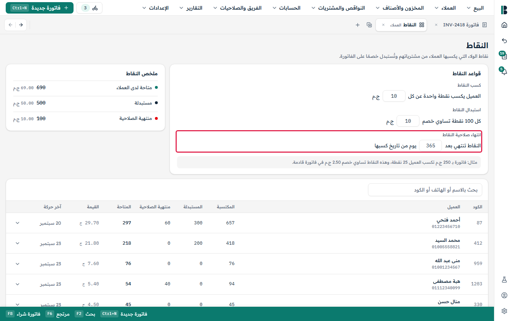

[Video PQ-24](PQ-24.webm)

#### `PQ-26` Order of discounts when there is a contract

**What the design does today:** When an invoice has a contract («تعاقد»), the design applies discounts in this order: first each line's discount, then the contract discount, then the invoice discount and the points discount.

**What we need you to decide:** Is this order right?

**Our suggestion:** Keep the design's order.

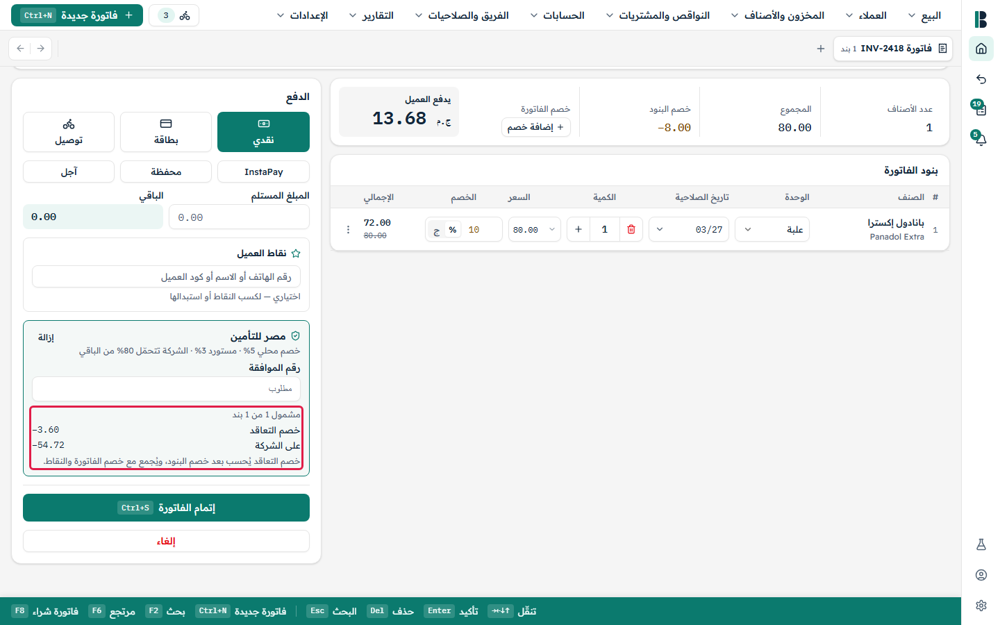

[Video PQ-26](PQ-26.webm)

#### `PQ-27` Taking the contract from the customer

**What the design does today:** The contract screen says a customer's contract applies by itself when you pick the customer. But on the sales screen, the cashier must pick the contract by hand. The two don't match.

**What we need you to decide:** Which one is right?

**Our suggestion:** The cashier picks the contract by hand. The customer's own contracts appear first in the list.

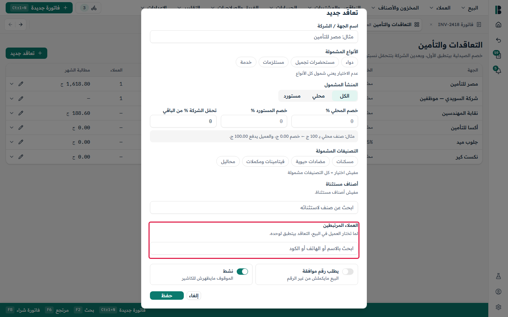

[Video PQ-27](PQ-27.webm)

#### `PQ-30` Receipt for a credit payment («تحصيل»)

**What the design does today:** A collection («تحصيل») is money a customer pays toward what they owe. It is taken on the «تحصيل من …» screen in «الحسابات الآجلة».

**What we need you to decide:** Should a collection print a receipt?

**Our suggestion:** Yes, with its own receipt number.

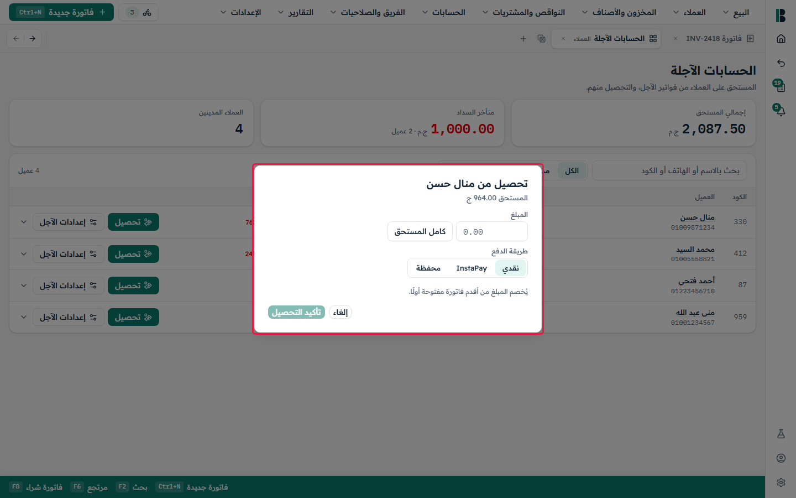

[Video PQ-30](PQ-30.webm)

### Stock, counting and purchasing

#### `PQ-9` Posting a count («ترحيل الجرد»)

**What the design does today:** In the design, «ترحيل الجرد» only marks the count as posted. Stock does not change.

**What we need you to decide:** Should posting change stock to match what was counted? If yes: when units are missing («عجز الجرد») or extra («زيادة الجرد»), which expiry date are they taken from or added to?

**Until you answer, we build:** Omar left this open, so there is no default yet. Posting only marks the count as posted, as in the design.

**Our suggestion:** Posting corrects stock. Missing units come off the earliest expiry first. Extra units go to the latest expiry in that store.

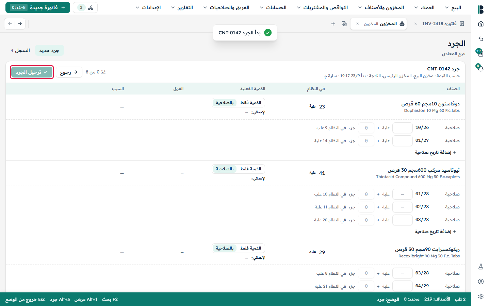

[Video PQ-9](PQ-9.webm)

#### `PQ-7` A count finds an expiry date that has no batch

**What the design does today:** During a count, staff can add an expiry date that Buret doesn't have («إضافة تاريخ صلاحية»). The design doesn't say what happens to it when the count is posted.

**What we need you to decide:** Does posting create a new batch for it? At what cost? Who must approve it?

**Until you answer, we build:** Omar left this open, so there is no default yet. The row is saved, and stock does not change.

**Our suggestion:** Create a new batch marked «من الجرد», at the last purchase cost. Only a manager can do this.

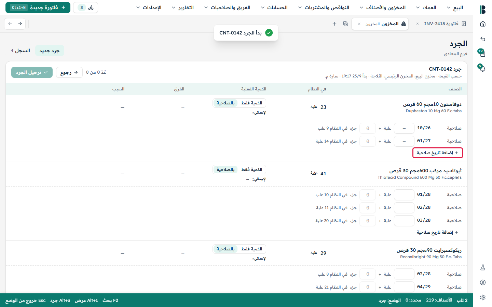

[Video PQ-7](PQ-7.webm)

#### `PQ-15` After a write-off («إعدام»): tell someone, or wait for approval?

**What the design does today:** After a write-off, the design shows the message «تم إبلاغ المدير» (the manager was told). But nothing is sent. The notification bell also shows a sample item «إعدام بانتظار الموافقة» (write-off waiting for approval).

**What we need you to decide:** Should a write-off notify someone, for example the owner? Or should it wait for approval before it takes effect?

**Our suggestion:** It takes effect right away, with no notice and no approval, as in the design.

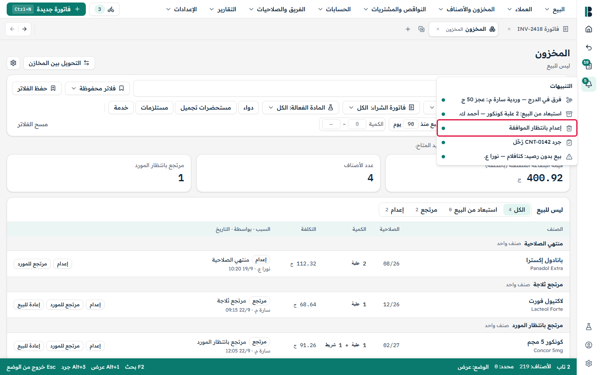

[Video PQ-15](PQ-15.webm)

#### `PQ-14` The «إعدام» tab on the «ليس للبيع» page

**What the design does today:** The «ليس للبيع» page has a «إعدام» tab. No step in the design puts anything in it.

**What we need you to decide:** What belongs in this tab?

**Our suggestion:** Follow the design's sample data: items set aside as «منتهي الصلاحية» or «صنف ممنوع تداوله» appear under «إعدام».

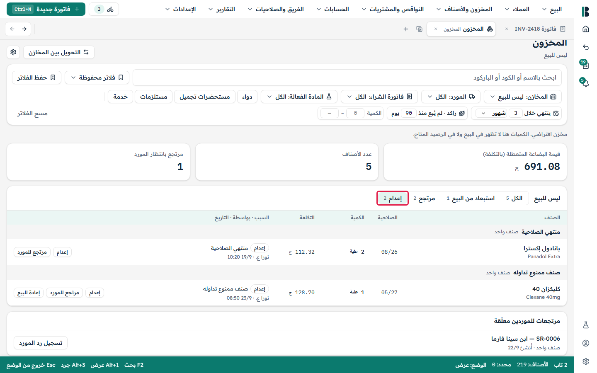

[Video PQ-14](PQ-14.webm)

#### `PQ-12` Deleting an item

**What the design does today:** After an item is deleted, the design shows «تراجع» (undo) for 5 seconds. After that, the item is gone.

**What we need you to decide:** Are 5 seconds enough? Or should deleted items stay visible and be restorable later? Who may delete items?

**Our suggestion:** Only the 5-second undo, with no page to restore deleted items. Only people with the «حذف صنف» permission can delete (see D2).

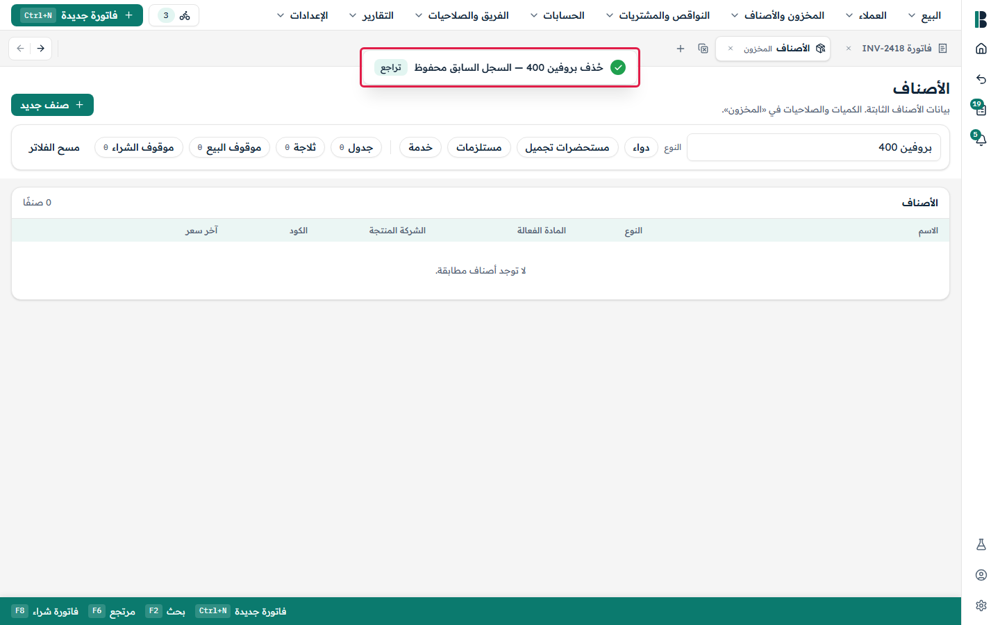

[Video PQ-12](PQ-12.webm)

#### `PQ-13` Two batches with the same expiry date

**What the design does today:** An item can have two batches with the same expiry date but a different price or cost. The screenshot shows where an item's batches are listed («تواريخ الصلاحية»).

**What we need you to decide:** Should they show as separate rows?

**Our suggestion:** One row per batch on the stock page, as in the design. Counting and setting stock aside group batches by expiry date.

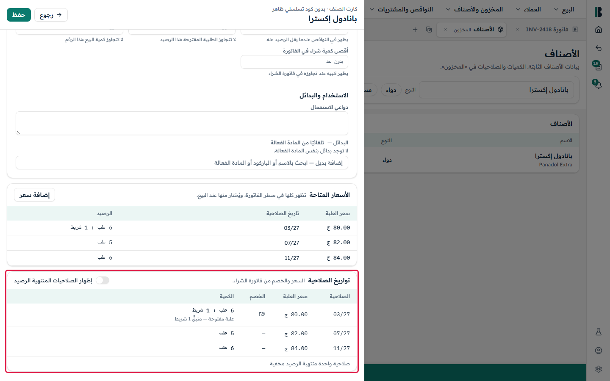

[Video PQ-13](PQ-13.webm)

#### `PQ-37` Cancelling an approved purchase invoice

**What the design does today:** In the design, an approved purchase invoice opens read-only («معتمدة — للعرض فقط»). It can't be edited or cancelled.

**What we need you to decide:** Do you need a way to reverse a purchase invoice after it is approved?

**Our suggestion:** No. Fix mistakes with a return to the supplier.

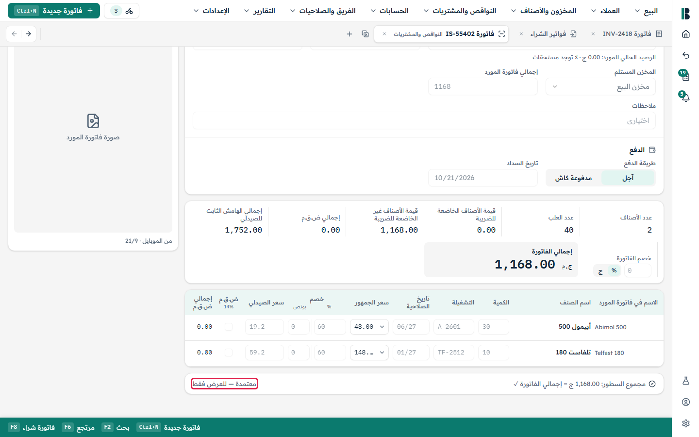

[Video PQ-37](PQ-37.webm)

#### `PQ-39` An order sent to a supplier that never arrives

**What the design does today:** Once an item is ordered from a supplier, it is hidden from «كشكول النواقص» and from the suggestions until the purchase invoice arrives. If the order never comes, the item stays hidden forever. The design has no way to cancel a sent order.

**What we need you to decide:** Should a sent order be cancellable? Should it expire after some time, or remind someone?

**Until you answer, we build:** As in the design.

**Our suggestion:** Each line of a sent order can be cancelled with the reason «لم يتوفر لدى المورد». The item then goes back to «كشكول النواقص».

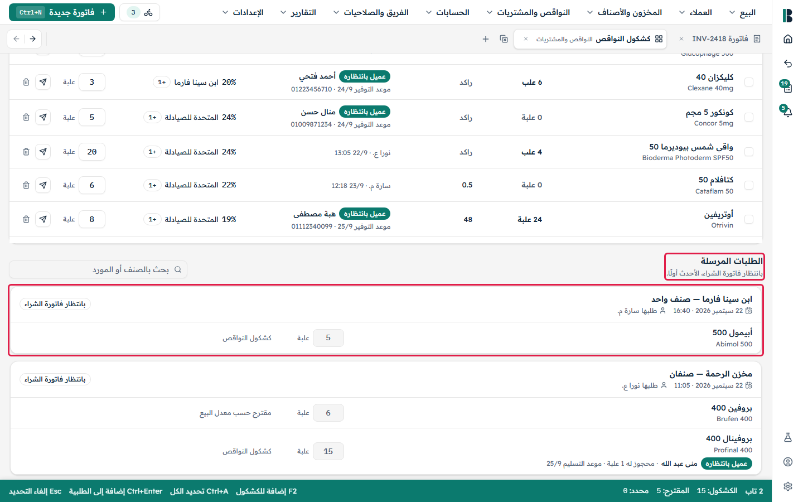

[Video PQ-39](PQ-39.webm)

#### `PQ-40` The same supplier bill entered twice

**What the design does today:** The design doesn't check for this. You can enter a bill with a number already used for the same supplier, and nothing warns you.

**What we need you to decide:** If the same supplier and bill number are entered again, should Buret warn, or block it?

**Until you answer, we build:** As in the design (no check).

**Our suggestion:** Warn when the supplier and bill number match an earlier bill.

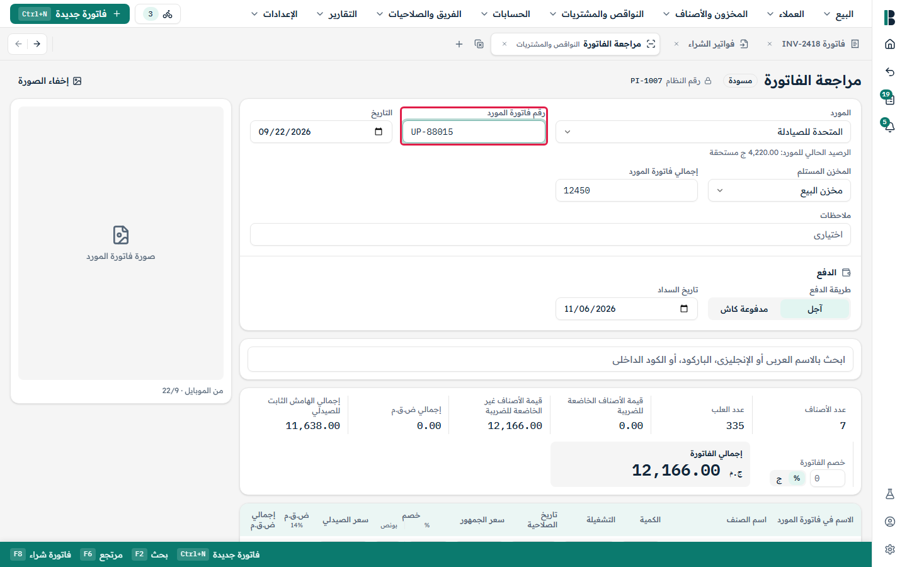

[Video PQ-40](PQ-40.webm)

#### `PQ-41` Draft purchase invoices: shared or personal

**What the design does today:** The design lists everyone's drafts together («مسودات بانتظار المراجعة»). A draft doesn't show who made it, and two people can open it at the same time.

**What we need you to decide:** Should drafts be shared by everyone, or belong to the person who made them?

**Our suggestion:** Shared, as in the design, and saved automatically.

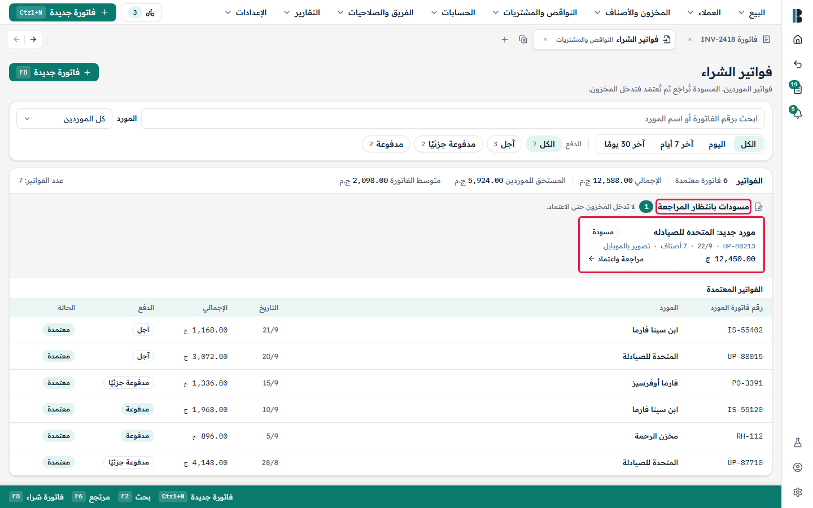

[Video PQ-41](PQ-41.webm)

#### `PQ-42` Supplier minimum order («حد الطلبية»)

**What the design does today:** The supplier page stores and shows a minimum order amount. Nothing uses it.

**What we need you to decide:** Should it do something? For example, warn when an order is below it.

**Our suggestion:** Store it and show it. Nothing more.

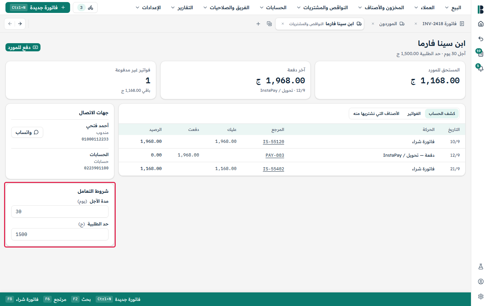

[Video PQ-42](PQ-42.webm)

#### `PQ-43` Where does «أعلى خصم» come from?

**What the design does today:** «كشكول النواقص» has a «أعلى خصم» (best discount) column. Today it shows sample data only.

**What we need you to decide:** Where should the number come from: the last purchase invoice line, or a list of supplier offers? Or should we drop the column?

**Until you answer, we build:** Not built yet.

**Our suggestion:** Take it from the latest approved purchase invoice line for that supplier and item. Hide it when there is none.

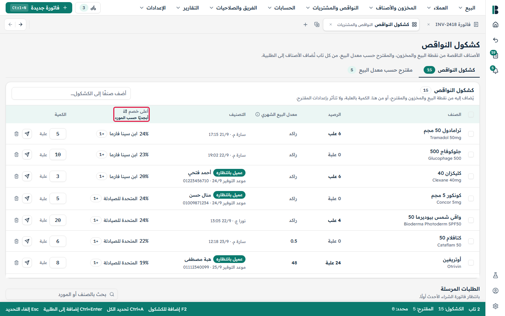

[Video PQ-43](PQ-43.webm)

### Setup and moving from B-Connect

#### `PQ-31` Bringing customers and their balances from B-Connect

**What the design does today:** In the design, moving a pharmacy from B-Connect takes six steps. They end at «المخزون المنقول» (stock moved). None of them covers customers or what they owe.

**What we need you to decide:** What should the step that reviews the moved customers look like?

**Our suggestion:** Customers, their credit terms, and one opening balance each (dated on the day of the move) are brought in. A review step lists them. We build that step from the design's existing parts.

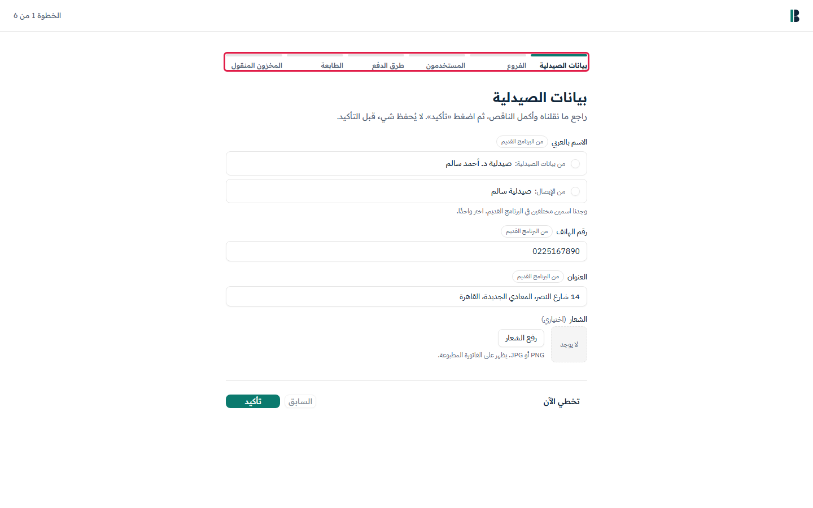

[Video PQ-31](PQ-31.webm)

### Later

#### `PQ-1` Login: B-Connect username and password, or name and PIN

**What the design does today:** The design's login screen is only a placeholder («شاشة الدخول لم تُصمَّم بعد»). The first version starts with the usernames and passwords people already use in B-Connect.

**What we need you to decide:** Keep that for the long term? Or move to picking your name and typing a short PIN on shared tills?

**Our suggestion:** The first version works as above. A new pharmacy (not moving from B-Connect) creates passwords at first login. Name and PIN can come after the trial, if you want it.

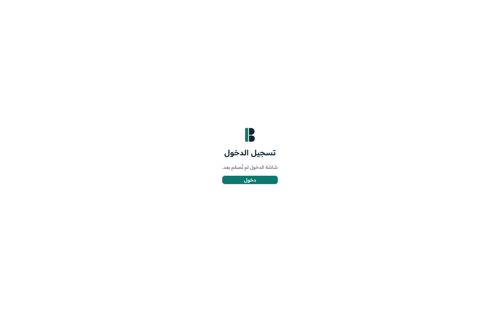

[Video PQ-1](PQ-1.webm)

## Mostafa (design)

Most items here are places where Buret will work differently from the design on purpose. Omar decided each one on 30 October 2026. "The design" is what the screens do today. "Buret" is what we will build. Mostafa: please check that the screens still make sense. Many of these are also rules about stock or money, so Moaz, please confirm them too. Two items are open questions: PQ-32 and PQ-46.

### Sales, returns, customers and the cash drawer

#### `PQ-32` The words «العملاء المدينين» and «مدينين»

**What the design does today:** The «الحسابات الآجلة» page uses «العملاء المدينين» and «مدينين». The design's own language rule keeps «مدين» for the accounting pages only (the journal and the trial balance).

**What we need you to decide:** Keep these labels, or reword them?

**Our suggestion:** Keep them as designed.

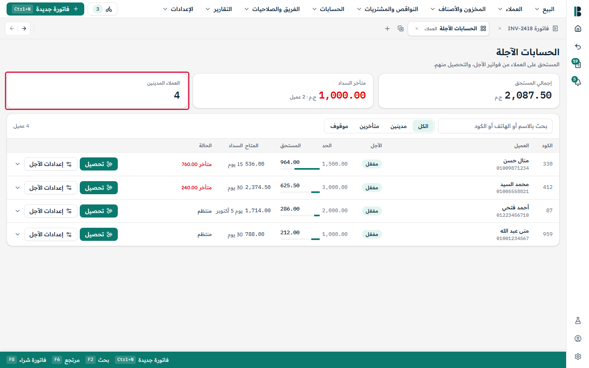

[Video PQ-32](PQ-32.webm)

#### `D3` Editing a delivery order

**The design:** The lines of a registered delivery order are changed in place.

**What Buret will do:** Same screens. But each change is saved as a new entry: a stock correction and a new version of the receipt. The sale becomes final at «تحصيل», when the money is collected.

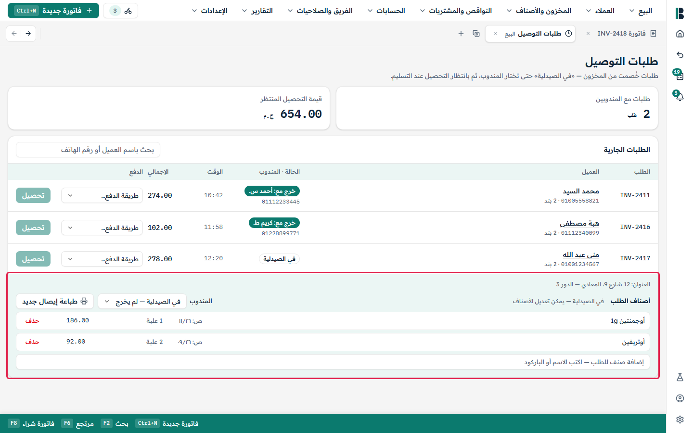

[Video D3](D3.webm)

#### `D4` Returning a credit («آجل») invoice

**The design:** It always offers a «نقدي» (cash) refund, even when the customer hasn't paid yet.

**What Buret will do:** The return first lowers what the customer owes. Cash goes back only for the part they already paid.

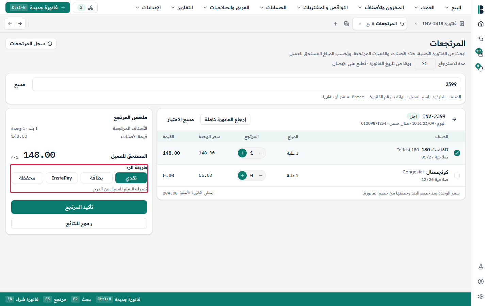

[Video D4](D4.webm)

#### `D5` Discount limits

**The design:** Fixed limits of 20% per line and 10% per invoice apply to everyone, even the owner.

**What Buret will do:** The owner may go above them. They apply to everyone else.

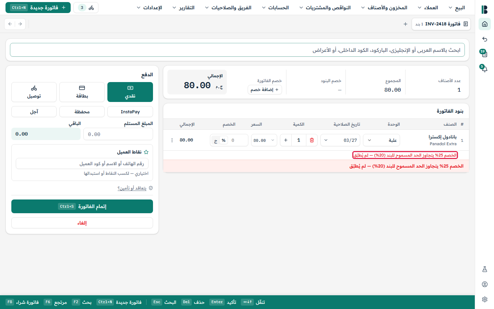

[Video D5](D5.webm)

#### `D6` Return period

**The design:** «مدة الاسترجاع» is printed on the receipt but never checked. Anyone can change it on the returns page.

**What Buret will do:** The period is enforced. A late return needs a special permission and is recorded. The setting moves off the returns page.

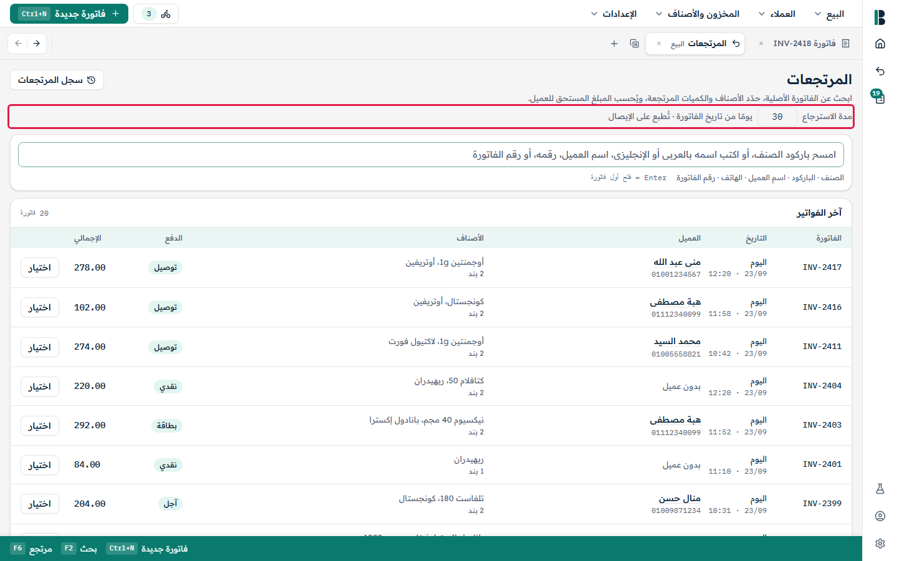

[Video D6](D6.webm)

#### `D7` Controlled drugs («صنف جدول»)

**The design:** When a controlled drug is sold, the three check boxes are not saved, and the «بيع صنف جدول» permission is never checked.

**What Buret will do:** The three ticks are saved with the sale, and the permission is checked.

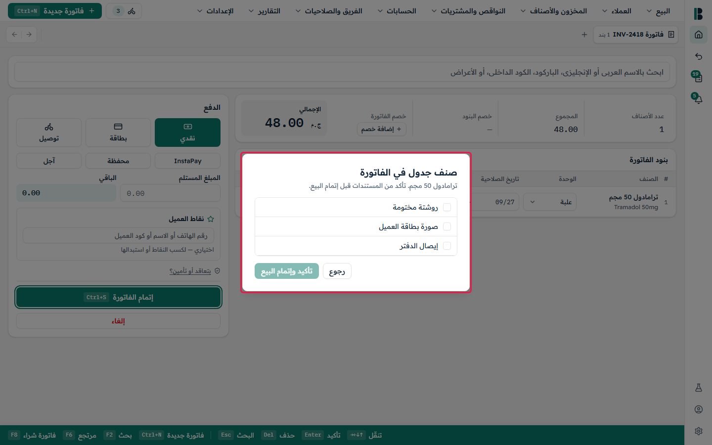

[Video D7](D7.webm)

#### `D8` The cashier's menu

**The design:** A cashier sees every page under «البيع».

**What Buret will do:** The menu shows only what the cashier may use. What a role can't use is hidden, not greyed out.

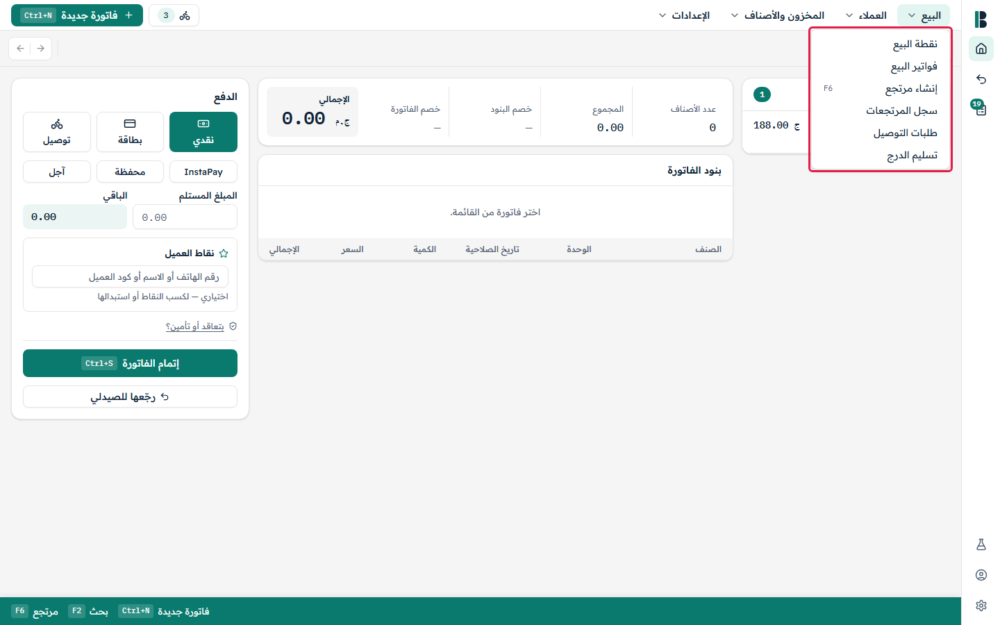

[Video D8](D8.webm)

#### `D9` Deleting a customer

**The design:** «حذف» removes the customer, without checking whether they owe money.

**What Buret will do:** Same screen, but the customer is archived; their history and account are kept. Buret refuses while they owe money.

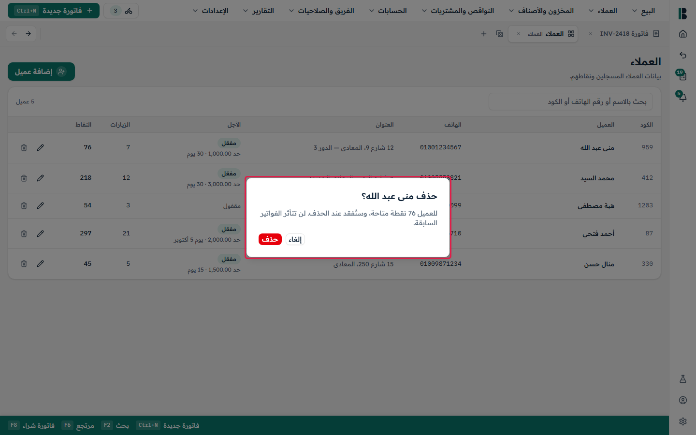

[Video D9](D9.webm)

#### `D10` Who may change customer settings

**The design:** Every role can edit customers, credit limits, points rules and contracts.

**What Buret will do:** Each of these has its own permission. Quickly adding a customer from the sales screen stays open to everyone.

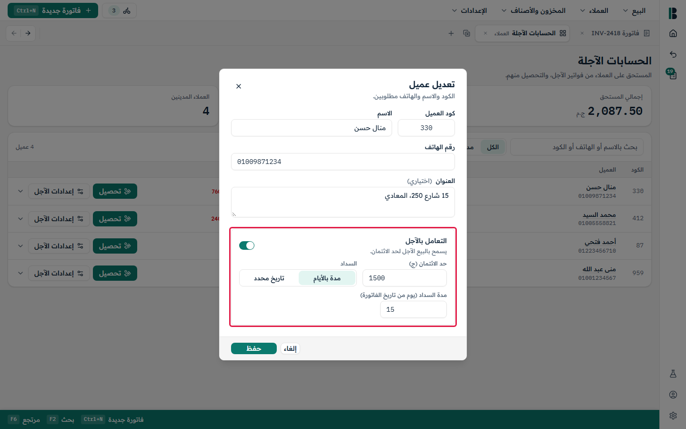

[Video D10](D10.webm)

#### `D11` Credit payments and the drawer

**The design:** Cash from a «تحصيل» never counts in the cash the drawer should hold.

**What Buret will do:** It counts, so collections don't show up as extra cash in the drawer.

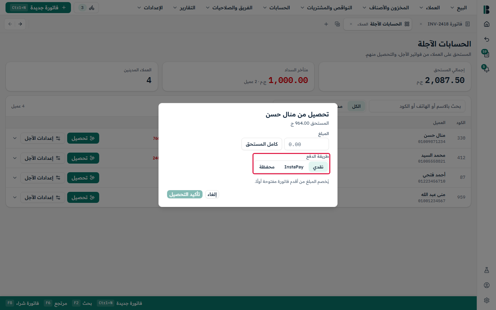

[Video D11](D11.webm)

#### `D12` Discounts bigger than the total

**The design:** If discounts add up to more than the invoice total, the design shows the total as 0.

**What Buret will do:** Buret refuses the invoice.

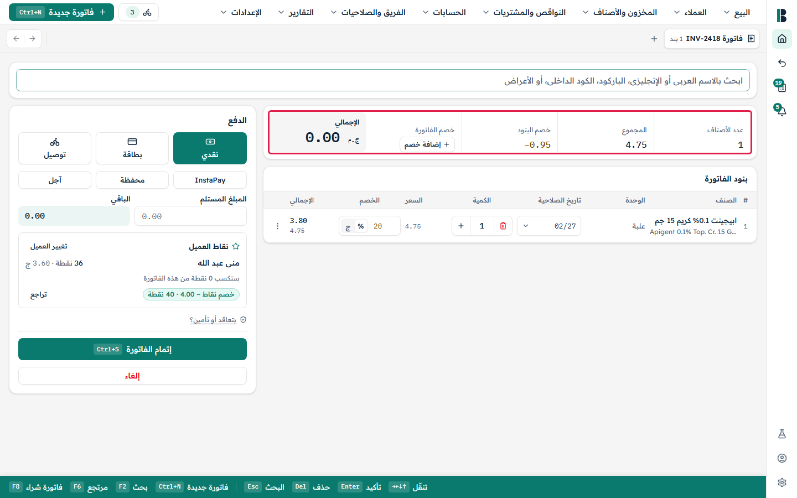

[Video D12](D12.webm)

#### `D13` Points on credit sales

**The design:** Points are earned and spent right away.

**What Buret will do:** No points until PQ-25 is answered.

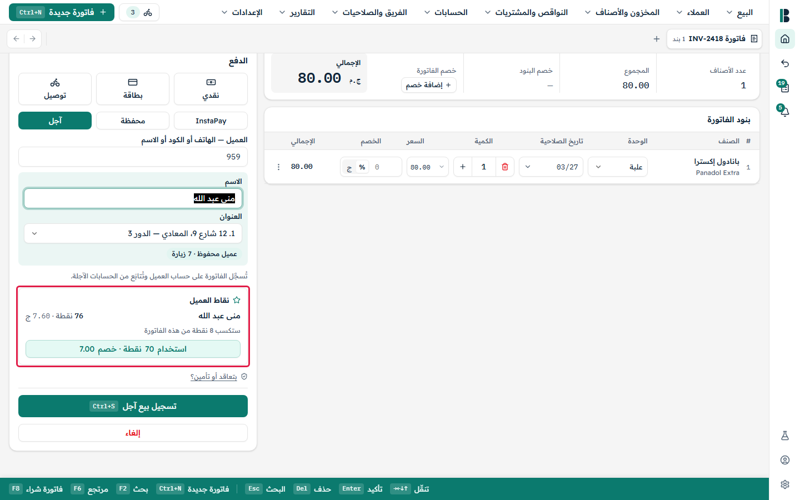

[Video D13](D13.webm)

#### `D14` Points on a return

**The design:** Points don't change.

**What Buret will do:** Points earned on the returned items are taken back (see PQ-23).

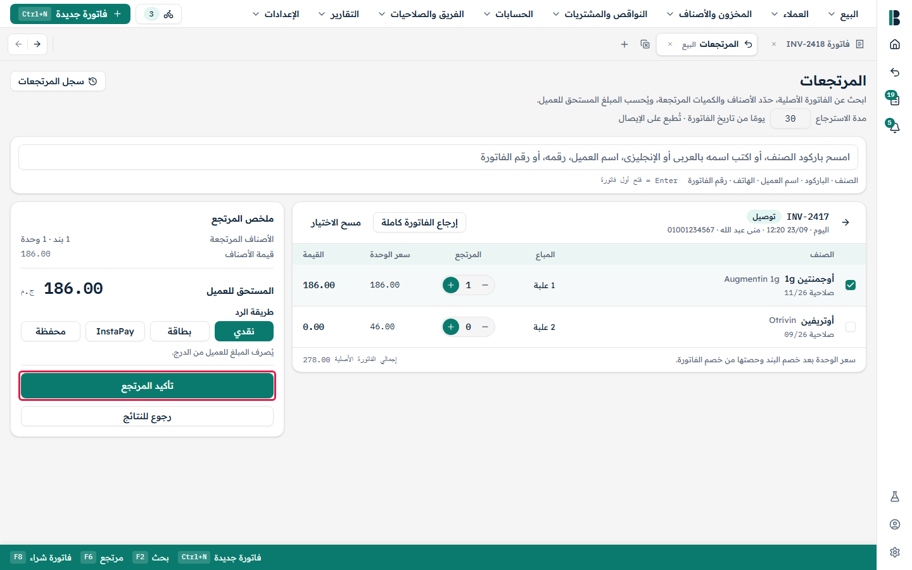

[Video D14](D14.webm)

### Stock, counting and purchasing

#### `PQ-44` The «طلبية مفتوحة — لم تُرسل بعد» card

**What the design does today:** On «كشكول النواقص», this card fills only when you press Ctrl+Enter. When it is empty, its text points to a button that doesn't exist.

**What we need you to decide:** Keep the card, or remove it?

**Until you answer, we build:** Keep it as designed.

**Our suggestion:** Remove it, and keep one way to order: «طلب من مورد».

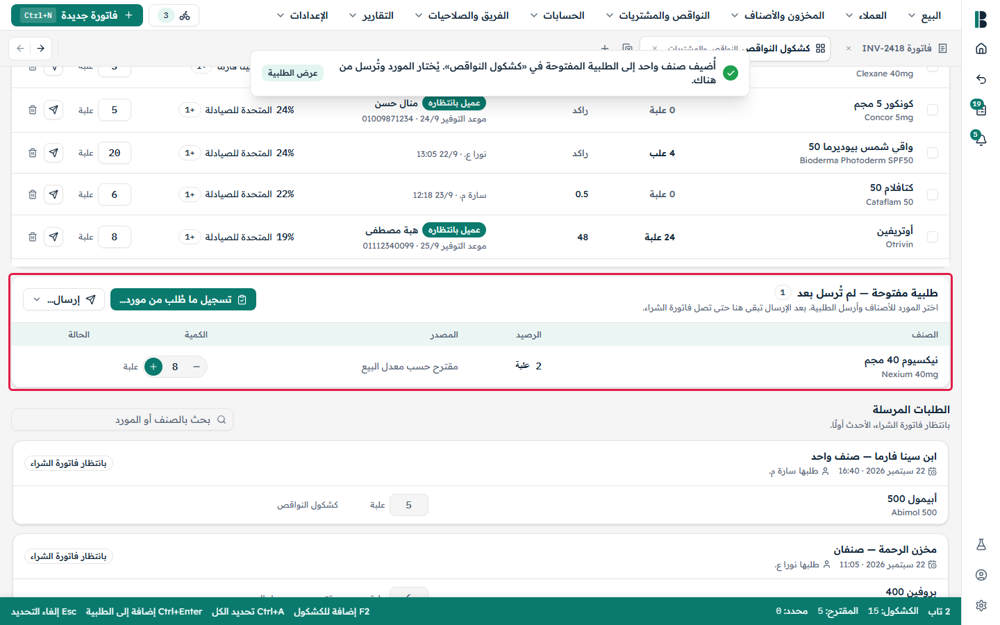

[Video PQ-44](PQ-44.webm)

#### `PQ-46` Reading a bill photo: waiting and failure

**What the design does today:** When staff upload a photo of a supplier bill, the design opens a filled draft at once. It shows nothing while the bill is being read, and nothing if reading fails. (Omar has already chosen the service that reads the bills.)

**What we need you to decide:** What should staff see while a bill is being read? And when reading fails?

**Until you answer, we build:** Nothing is drawn yet.

**Our suggestion:** A simple waiting state that says the bill is being read. If reading fails, an empty draft to fill in by hand, with a short message.

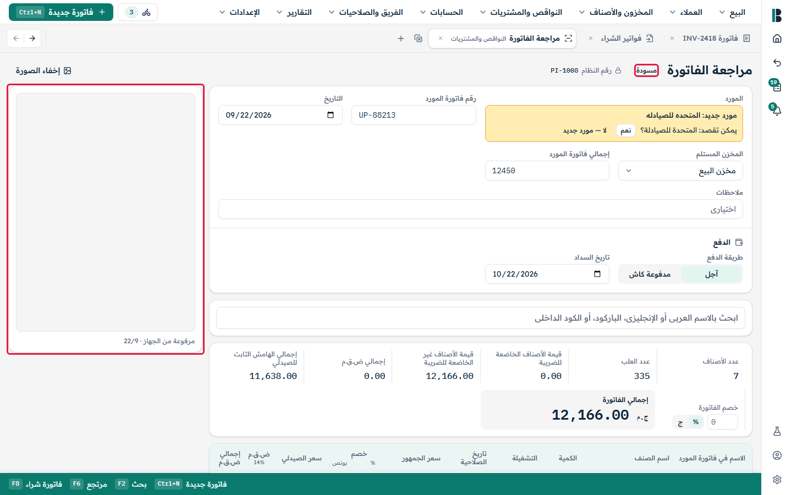

[Video PQ-46](PQ-46.webm)

#### `D1` Who may write off stock

**The design:** The manager role may write off stock directly.

**What Buret will do:** Write-off («إعدام») is its own permission. By default, the manager and the owner have it.

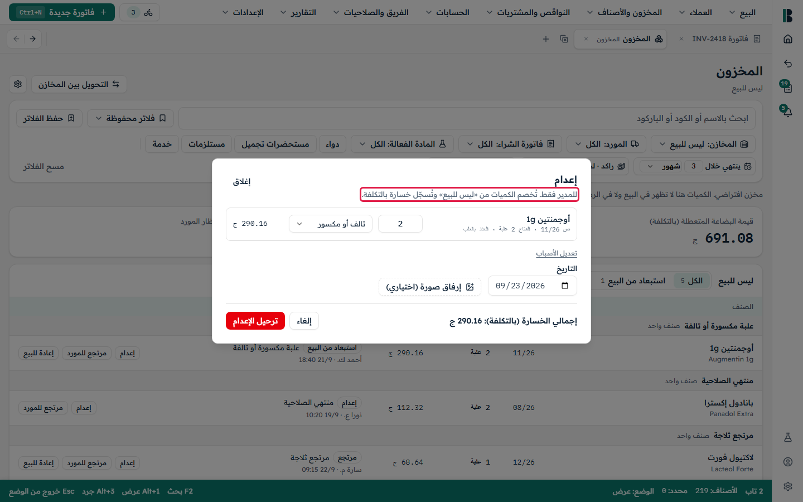

[Video D1](D1.webm)

#### `D2` Who may delete an item

**The design:** The «حذف صنف» permission exists but is never checked. Anyone can delete.

**What Buret will do:** The permission is checked.

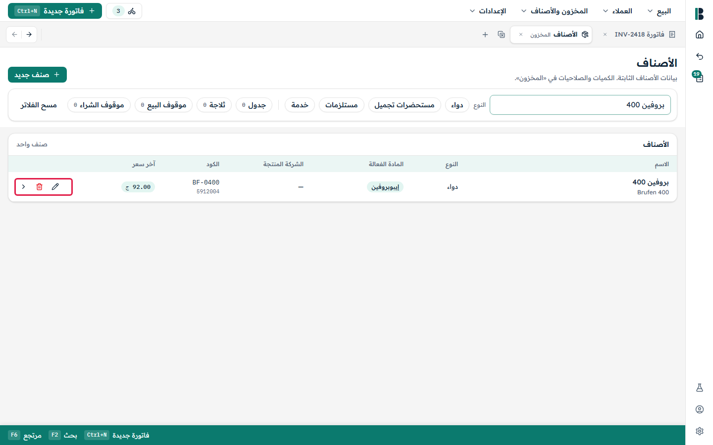

[Video D2](D2.webm)

#### `D15` Closing a return to a supplier

**The design:** When the supplier's answer is recorded, nothing is taken off what the pharmacy owes that supplier. Also, «مرتجع للمورد» replaces the original reason the stock was set aside.

**What Buret will do:** The value the supplier accepts is taken off what the pharmacy owes that supplier, and the original reason is kept. «السعر» starts at the batch cost (this copy of the design already fills it in).

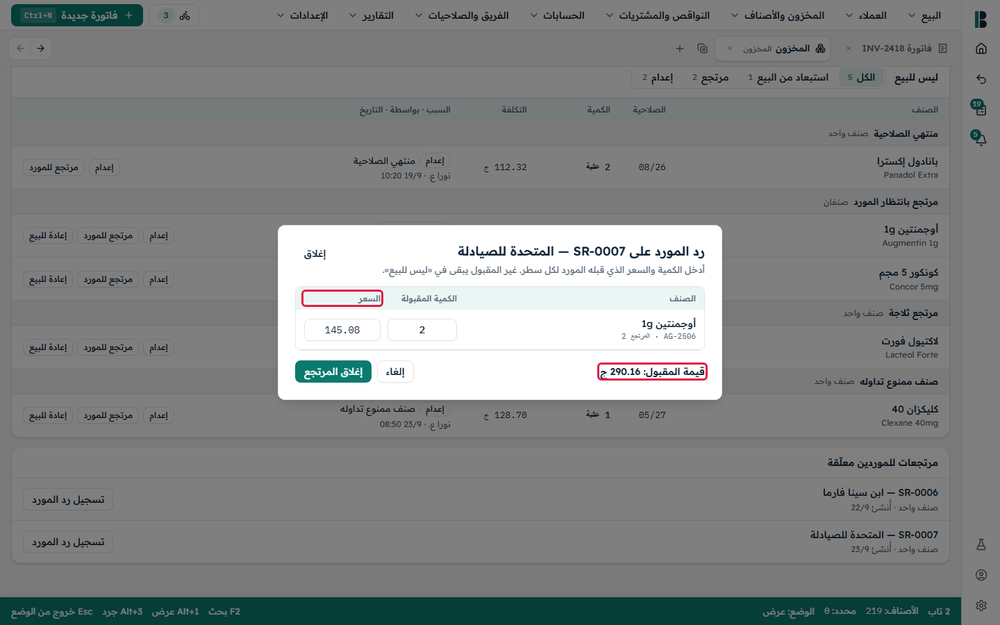

[Video D15](D15.webm)

#### `D16` The supplier when a bill is approved

**The design:** If the «يمكن تقصد…؟» (did you mean…?) question is left unanswered, approving creates a new supplier.

**What Buret will do:** Approving waits until the question is answered.

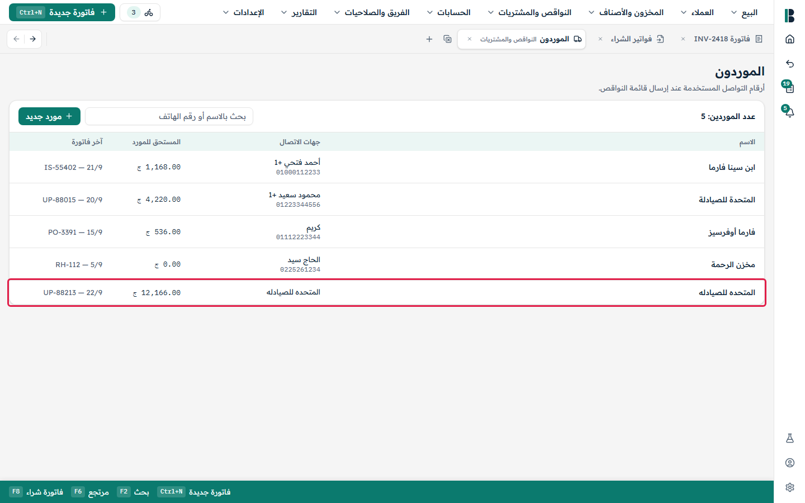

[Video D16](D16.webm)

#### `D17` Price labels after a bill is approved

**The design:** The label prints the price of an older batch.

**What Buret will do:** The label prints the new batch's own price.

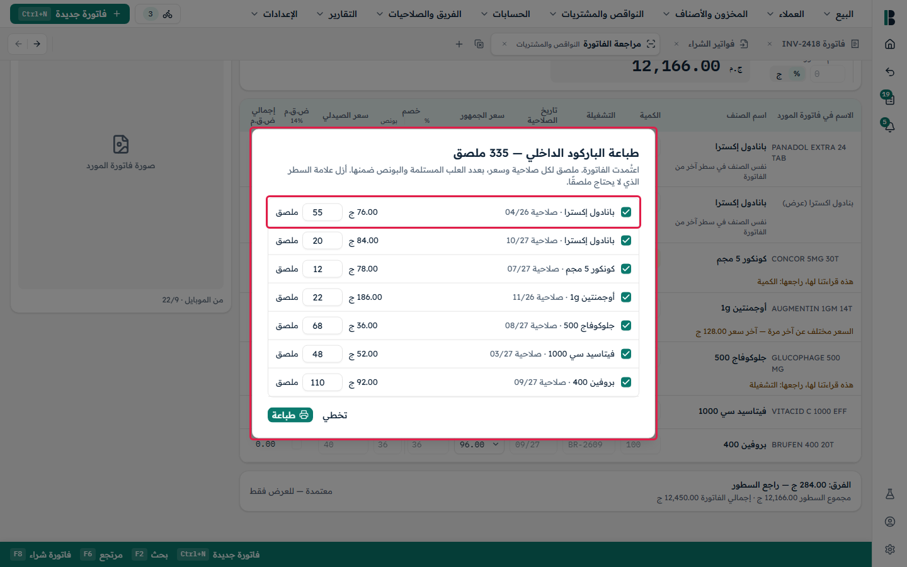

[Video D17](D17.webm)

## Pharmacist

### Sales, returns, customers and the cash drawer

#### `PQ-21` Controlled-drug register («دفتر»)

**What the design does today:** When a controlled drug («صنف جدول») is sold, the design asks for three ticks («صنف جدول في الفاتورة»).

**What we need you to decide:** Does the law require a register beyond these three ticks? If yes, what must it hold?

**Our suggestion:** Save the three ticks with the sale. No register in the first version.

[Video PQ-21](PQ-21.webm)

### Stock, counting and purchasing

#### `PQ-11` Rules for writing off stock («الإعدام»)

**What the design does today:** In the design, a manager writes off stock and prints a «محضر إعدام أصناف» (write-off report).

**What we need you to decide:** Do Egyptian rules require more than this? For example, a committee, a form from the health directorate, or special rules for controlled drugs.

**Our suggestion:** A manager alone, an optional photo, and «توقيع المدير» on the printed «محضر إعدام أصناف».

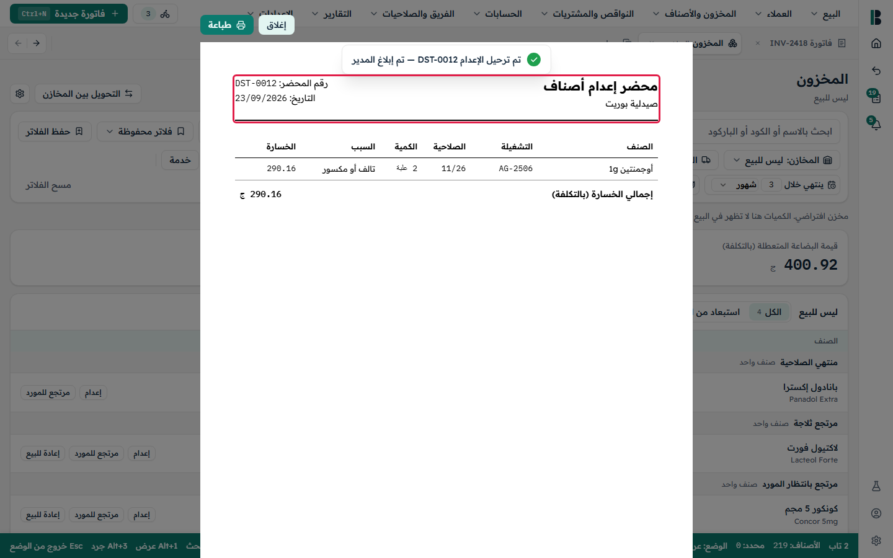

[Video PQ-11](PQ-11.webm)

#### `PQ-38` Discount % and bonus boxes on supplier bills

**What the design does today:** The design links them. On a bill line, a 10% discount on 50 boxes adds 5 bonus («بونص») boxes by itself. The same % also lowers the pharmacist price.

**What we need you to decide:** Is that how supplier bills really work?

**Our suggestion:** Keep them linked, as designed.

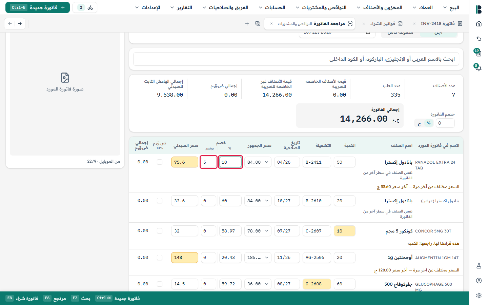

[Video PQ-38](PQ-38.webm)

#### `PQ-36` Receiving expired or nearly expired stock

**What the design does today:** The design doesn't check expiry dates when a bill is received. The sample bill even has an expired line, and nothing flags it.

**What we need you to decide:** Should Buret block such stock, or allow it with a warning? (Moaz may also have a view.)

**Our suggestion:** Allow it, and flag it on the review screen. Expired stock can never be sold.

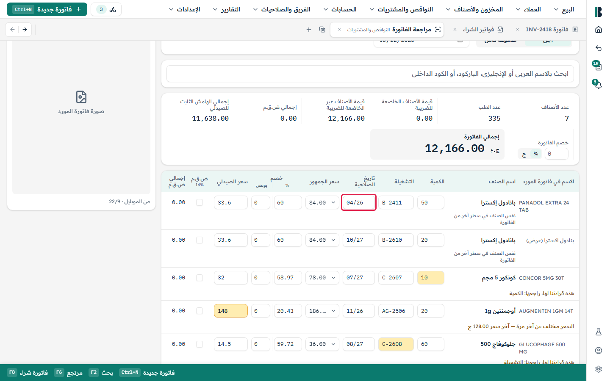

[Video PQ-36](PQ-36.webm)

#### `PQ-8` Items with no expiry date («بدون صلاحية»)

*Also affects moving from B-Connect.*

**What the design does today:** The design has no «بدون صلاحية» option. Every batch has an expiry date, so there is no screenshot for this one.

**What we need you to decide:** Which kinds of items may have no expiry date? Are they sold like any other item?

**Our suggestion:** Any item can be marked «بدون صلاحية», as in B-Connect. Its batches sell normally, after the batches that have a date. When data is brought in from B-Connect, Buret flags undated batches on items that should have a date.

*No screenshot: the design has no screen for this.*

## Accountant

### Stock, counting and purchasing

#### `PQ-33` VAT on purchases: before or after the invoice discount?

**What the design does today:** On a purchase invoice, the design adds VAT («ض.ق.م») on each line first, then takes the invoice discount off the total. So «إجمالي ض.ق.م» (total VAT) does not change when there is a discount.

**What we need you to decide:** Is that right, or should VAT be worked out after the discount?

**Until you answer, we build:** As in the design: VAT before the discount. VAT is stored exactly on each line, and the invoice discount is spread across the lines.

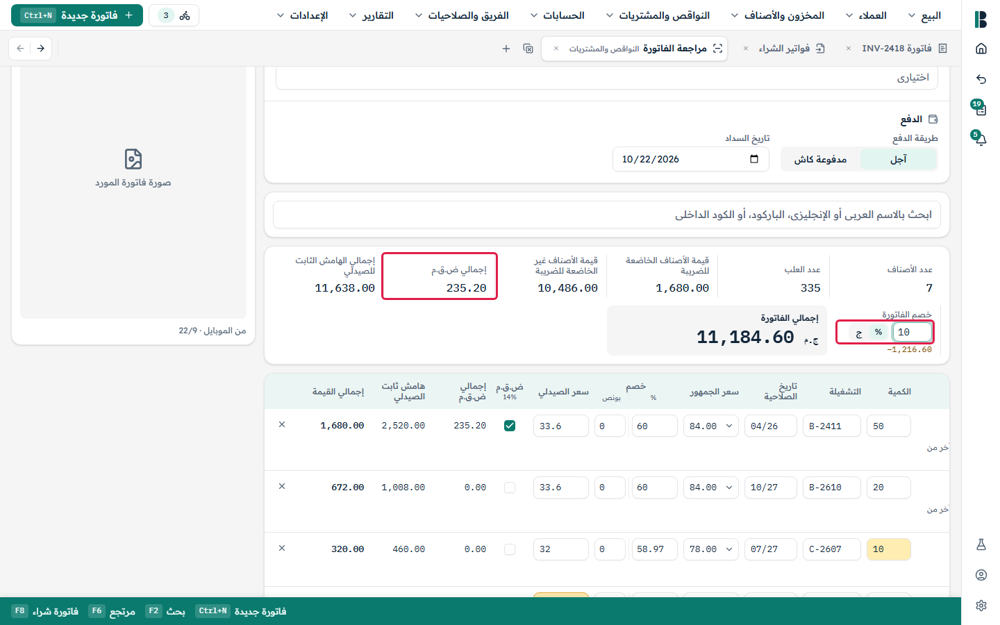

[Video PQ-33](PQ-33.webm)

#### `PQ-35` A bill total that doesn't match the sum of its lines

**What the design does today:** At approval, the design warns when the printed bill total and the sum of the lines differ («الفرق: … — راجع السطور»), and still allows approving.

**What we need you to decide:** When they differ, which amount does the pharmacy owe the supplier?

**Our suggestion:** The sum of the lines. Buret warns and allows approving, and the difference stays visible.

[Video PQ-35](PQ-35.webm)

#### `PQ-34` The value of a return to a supplier

**What the design does today:** When the supplier's answer is recorded, the design fills «السعر» with the batch's purchase cost and lets you edit it. «قيمة المقبول» (accepted value) = accepted quantity × that price.

**What we need you to decide:** Should the return be valued at the batch cost, or at the price the supplier accepts?

**Our suggestion:** «السعر» starts at the batch cost and can be edited. The accepted value is taken off what the pharmacy owes the supplier.

[Video PQ-34](PQ-34.webm)

#### `PQ-45` How long bill photos are kept

**What the design does today:** Staff can upload a photo of each supplier bill. The design says nothing about how long photos are kept.

**What we need you to decide:** How long must we keep them?

**Our suggestion:** As long as the invoice exists.

[Video PQ-45](PQ-45.webm)

### Later

#### `PQ-6` VAT and tax reports

*Reports.*

**What the design does today:** The design has a monthly VAT page («الضرائب»).

**What we need you to decide:** Does Buret need VAT or tax reports, for the pharmacy's accountant or for electronic invoicing? Or is correct VAT on each purchase line enough?

**Our suggestion:** VAT is stored correctly on each purchase line. No tax reports in the first version. The tax authority's electronic receipt comes in the second version.

[Video PQ-6](PQ-6.webm)

## Already decided by Omar (for your information)

- Moving stock to another store: while it is on its way it sits in a middle «في الطريق» (in transit) place. It cannot be sold from the sender, and the receiver gets it when they confirm receipt.
- Moaz confirmed: the first version is for a single pharmacy. Several pharmacies (chain mode) come right after, as their own step.
- Customer returns go back to stock, into the batch they were sold from.
- Medicine prices come from the batch received and are never edited. Changing the price of a non-medicine item needs a permission.
- The strip price is set once per batch: box price ÷ number of strips, rounded.
- One payment method per invoice. No split payment.
- Receipts print as an image, so Arabic letters join correctly.
